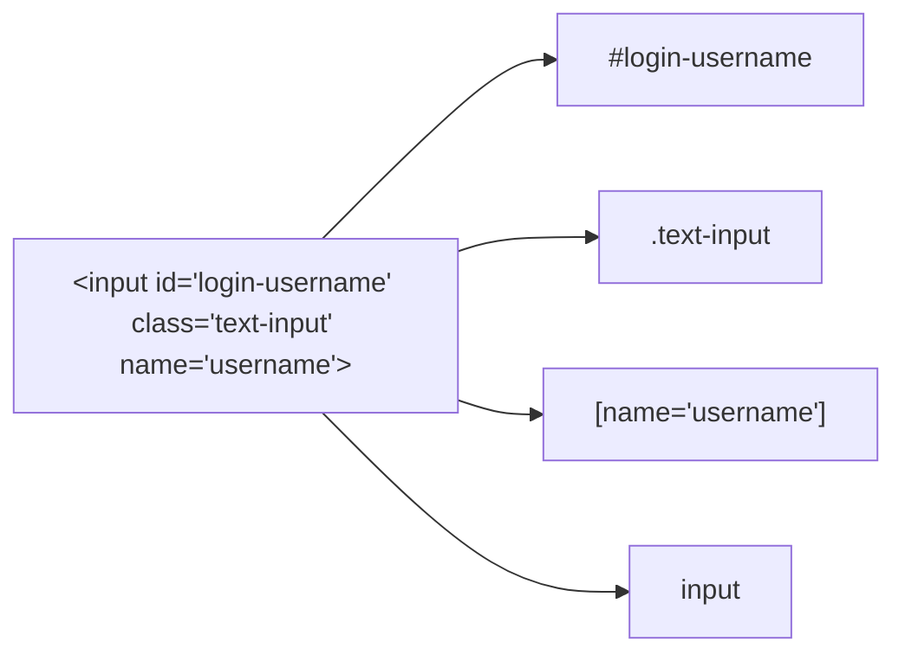
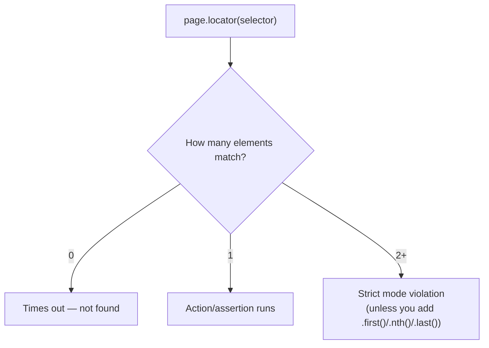
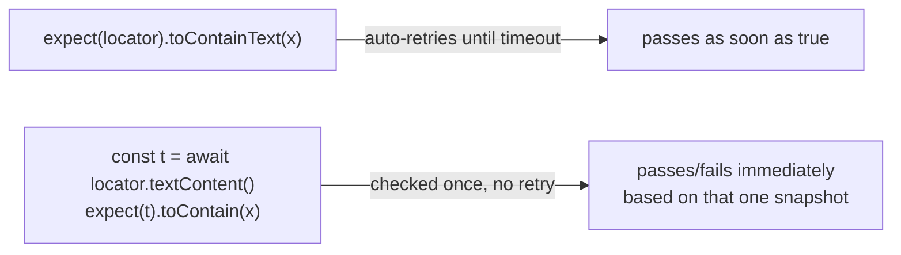

# 03_Locator_Commands — Notes

Notes for everything covered in `tests/03_Locator_Commands/`. Diagrams are in Mermaid
(renders natively on GitHub and in VS Code's Markdown preview).

## File map

| File | Concept it teaches |
|---|---|
| `225_LC.spec.ts` | Navigation options: `waitUntil`, per-navigation `timeout`, `referer` |
| `226_Refere.spec.ts` | Context-level `extraHTTPHeaders` — set a header for every request, not just one `goto` |
| `227_Fresh.spec.ts` | Default/built-in CSS locators (`#id`, `.class`, `[name=]`) on a real login form |
| `227_homework.spec.ts` | Same idea on a different site, plus an XPath locator |
| `228_17SepTask.spec.ts` | Mixing locator strategies in one test: CSS id, `getByLabel`, `getByRole`, `getByTestId` |
| `228_Project3.spec.ts` | XPath + attribute locators, `.first()`, reading text with `.textContent()` |
| `229_getByRole.spec.ts` | `getByRole` with `exact: true` to avoid partial accessible-name matches |
| `230_getByRole.spec.ts` | `getByRole('link', ...)` to drive navigation |

---

## 1. Default (built-in) CSS locators

Before reaching for `getByRole`/`getByTestId`, `227_Fresh.spec.ts` and `227_homework.spec.ts`
practice the plain CSS selectors every browser understands:

```ts
page.locator("#login-username");   // id          → #id
page.locator(".text-input");       // class       → .class
page.locator("[name='username']"); // attribute   → [attr=value]
page.locator("input");             // tag         → tag name
```



**Why it matters:** these are the locators you'll meet in legacy/non-accessible apps that
don't expose roles or `data-testid`. They work, but they're brittle — a class rename or a
duplicated id breaks the test. Prefer role/testid locators (see section 4) when the app
supports them.

---

## 2. XPath locators

`227_homework.spec.ts` and `228_Project3.spec.ts` reach for XPath when there's no
reliable id/class to anchor on — usually to match an element **by its visible text**:

```ts
page.locator("//h2[text()='Make Appointment']");
page.locator("//input[@id='free-trial-step1-email']");
page.locator("//div[contains(@class,'invalid-reason')]").first();
```

**Why `.first()` shows up here:** `//div[contains(@class,'invalid-reason')]` can match
more than one element on the page. Playwright's locators are "strict" by default — calling
an action/assertion on a locator that resolves to 2+ elements throws, instead of silently
picking one. `.first()` (or `.nth(n)`, `.last()`) is how you tell Playwright which match
you actually want.



---

## 3. Navigation options: `waitUntil`, `timeout`, `referer`

From `225_LC.spec.ts`:

```ts
await page.goto("https://app.thetestingacademy.com/login", {
  waitUntil: 'domcontentloaded', // don't wait for images/fonts/XHRs to finish
  timeout: 45000,                // override the default nav timeout for this call
  referer: 'https://thetestingacademy.com',
});
```

| `waitUntil` value | Resolves when... | Use it when |
|---|---|---|
| `'load'` (default) | the full `load` event fires (images, styles, etc.) | you need the page fully settled |
| `'domcontentloaded'` | HTML is parsed, DOM is ready | the page is slow due to late-loading assets you don't care about |
| `'commit'` | the server responded and navigation started | you only need to confirm the navigation began |
| `'networkidle'` | no network requests for 500ms | SPA apps that keep polling (use sparingly — can be slow/flaky) |

`referer` on `goto()` sets the `Referer` header for **that one navigation only**.

---

## 4. Context-level headers vs per-navigation options

`226_Refere.spec.ts` sets the same `Referer` header, but at the **context** level instead —
so it applies to *every* request that context makes, not just one `goto()`:

```ts
let context = await browser.newContext({
  extraHTTPHeaders: { "Referer": "https://thetestingacademy.com" },
});
let page = await context.newPage();
await page.goto("https://app.vwo.com/#login");       // gets the header
await page.goto("https://katalon-demo-cura...");     // also gets the header
```

**Rule of thumb:** one-off header for one navigation → pass it to `goto()`. A header that
should apply to the whole session (auth tokens, partner referers, locale headers) →
`extraHTTPHeaders` on `newContext()`.

---

## 5. Mixing locator strategies in one test

`228_17SepTask.spec.ts` shows that you're not locked into one locator style per test —
pick whichever is most reliable for each element:

```ts
await page.locator("#email").fill("Hello@abc.com");                       // CSS id
await page.getByLabel('password').fill("NotAPassword");                   // associated <label>
await page.getByRole('checkbox', { name: "Remember me" }).click();        // ARIA role
await page.getByTestId('login-button').click();                          // data-testid
```

**Bug worth fixing here:** the test ends with `await expect(page.url).not.toEqual(url)`.
`page.url` is a **function reference**, not the current URL — comparing it to a string will
never behave as intended. It should be `page.url()` (called), or better, the locator-style
assertion `await expect(page).not.toHaveURL(url)` which also auto-retries.

---

## 6. Reading text manually vs. asserting on a locator

`228_Project3.spec.ts` pulls text out with `.textContent()` and asserts on the resulting
string:

```ts
let error_message = page.locator("//div[contains(@class,'invalid-reason')]").first();
let error_message_text = await error_message.textContent();
expect(error_message_text).toContain("The email address you entered is incorrect.");
```

This works, but **`expect(string).toContain(...)` does not auto-retry** — it checks the
value once, at the moment `.textContent()` resolved. If the error message renders a moment
later, this can flake. The more robust, idiomatic form asserts directly on the locator:

```ts
await expect(error_message).toContainText("The email address you entered is incorrect.");
```

(`227_Fresh.spec.ts` actually already does it this second, better way — worth comparing
the two files side by side.)



---

## 7. `exact: true` on role locators

`229_getByRole.spec.ts` and `230_getByRole.spec.ts` use `exact: true` to stop `getByRole`
from matching on a partial/containing accessible name:

```ts
page.getByRole("textbox", { name: "Email", exact: true });
page.getByRole("link", { name: "Make Appointment", exact: true });
```

Without `exact: true`, `name: "Email"` would also match a field accessibly named
"Email Address" or "Confirm Email" — fine when there's only one such field, a source of
strict-mode violations when there's more than one.

---

## Quick recap

| Need | Reach for |
|---|---|
| No role/testid available | `#id`, `.class`, `[attr=value]`, tag locators |
| Match by visible text, no good attribute | XPath (`//tag[text()='...']`, `contains(@class,...)`) |
| Locator matches multiple elements | `.first()` / `.nth(n)` / `.last()` |
| One-off header for one navigation | `goto(url, { referer })` |
| Header for the whole session | `browser.newContext({ extraHTTPHeaders })` |
| Role name collides with a longer label | `getByRole(role, { name, exact: true })` |
| Assert on text from an element | `expect(locator).toContainText(x)` — not `textContent()` + plain `expect` |
