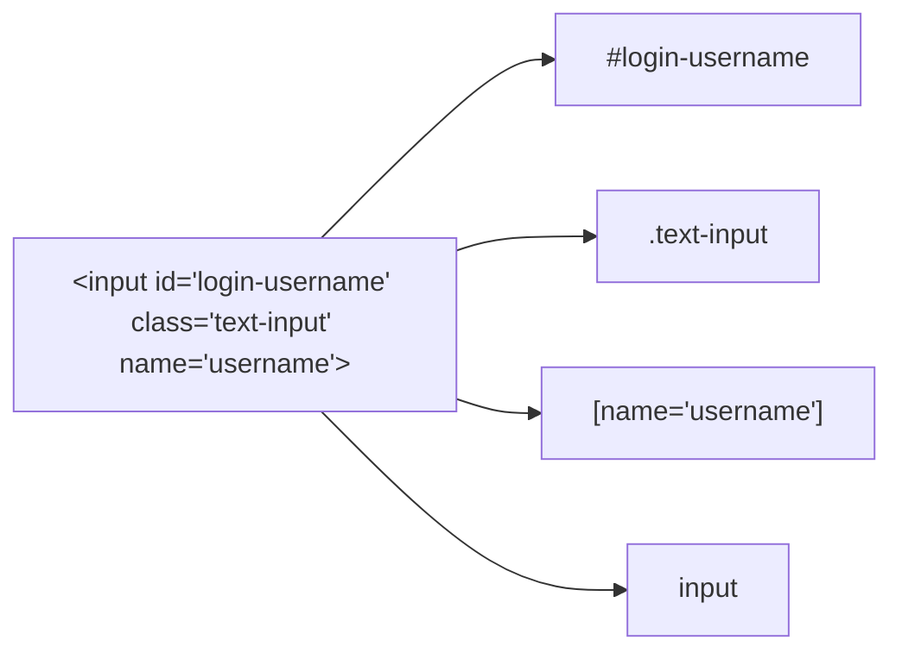
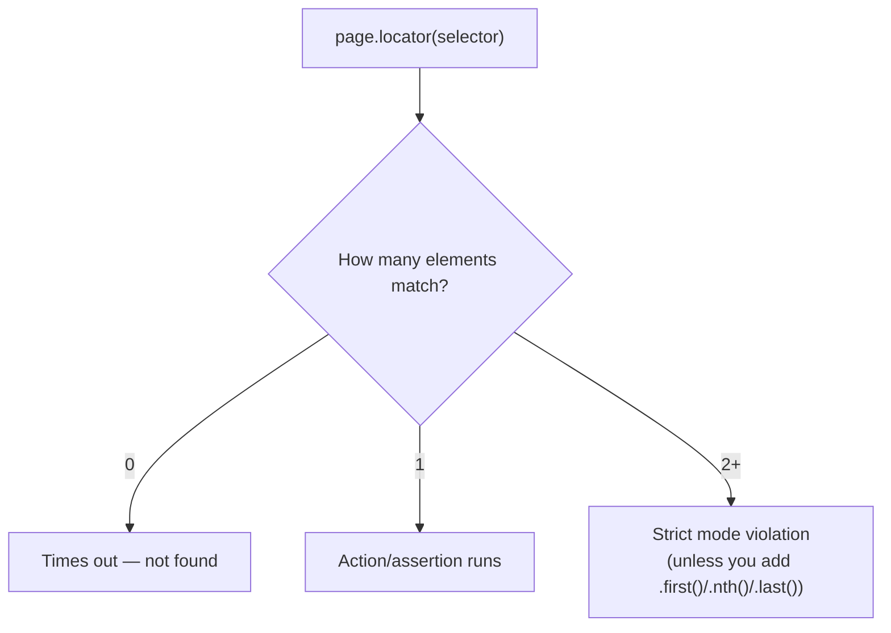
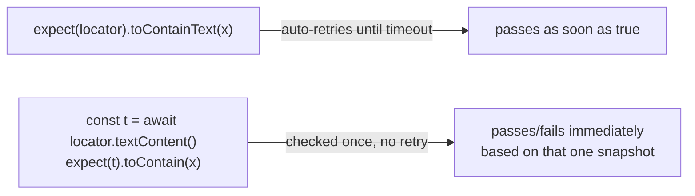
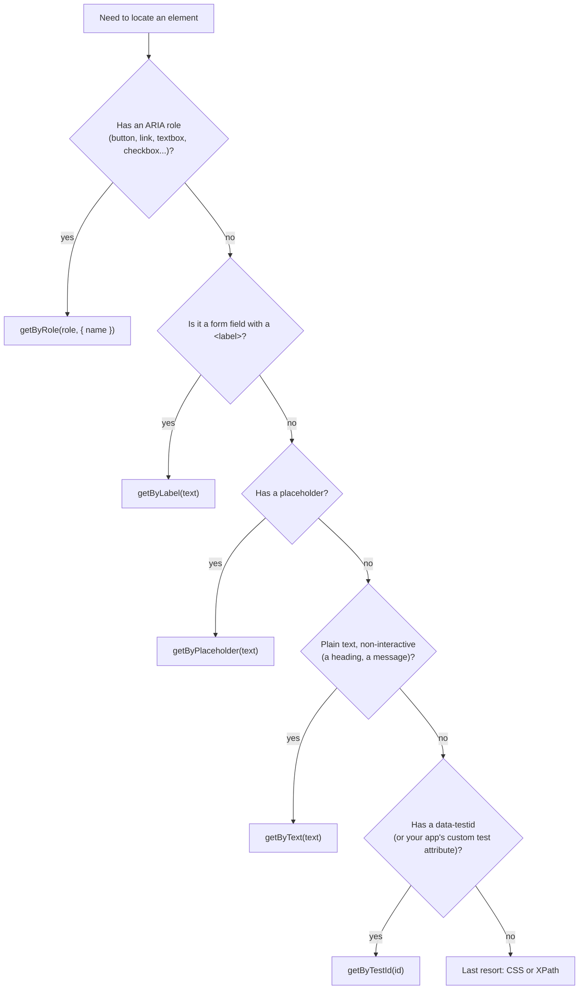
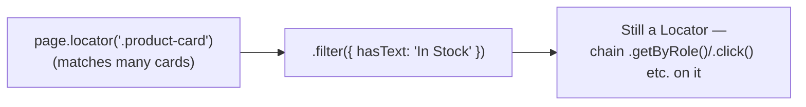

# 03_Locator_Commands — Notes

Two parts: **Part A** documents what's actually in `tests/03_Locator_Commands/` today
(a handful of CSS/XPath/role locators, picked up ad hoc per file). **Part B** is a full
lesson on every locator strategy Playwright supports — role, label, placeholder, text,
alt-text, title, test-id, CSS (including Playwright's own CSS extensions), XPath, chaining,
filtering, iframes, and shadow DOM — so this topic is covered completely, not just the
slice your files happen to use. Diagrams are in Mermaid (renders natively on GitHub and in
VS Code's Markdown preview).

## File map

| File | Concept it teaches |
|---|---|
| `225_LC.spec.ts` | Navigation options: `waitUntil`, per-navigation `timeout`, `referer` |
| `226_Refere.spec.ts` | Context-level `extraHTTPHeaders` — set a header for every request, not just one `goto` |
| `227_Fresh.spec.ts` | Default/built-in CSS locators (`#id`, `.class`, `[name=]`) on a real login form |
| `227_homework.spec.ts` | Same idea on a different site, plus an XPath locator |
| `228_17SepTask.spec.ts` | Mixing locator strategies in one test: CSS id, `getByLabel`, `getByRole`, `getByTestId` |
| `228_Project3.spec.ts` | XPath + attribute locators, `.first()`, reading text with `.textContent()` |
| `229_getByRole.spec.ts` | `getByRole` with `exact: true` to avoid partial accessible-name matches |
| `230_getByRole.spec.ts` | `getByRole('link', ...)` to drive navigation |

---

# Part A — What your files do today

## A1. Default (built-in) CSS locators

Before reaching for `getByRole`/`getByTestId`, `227_Fresh.spec.ts` and `227_homework.spec.ts`
practice the plain CSS selectors every browser understands:

```ts
page.locator("#login-username");   // id          → #id
page.locator(".text-input");       // class       → .class
page.locator("[name='username']"); // attribute   → [attr=value]
page.locator("input");             // tag         → tag name
```



**Why it matters:** these are the locators you'll meet in legacy/non-accessible apps that
don't expose roles or `data-testid`. They work, but they're brittle — a class rename or a
duplicated id breaks the test. Prefer role/testid locators (see section 4) when the app
supports them.

---

## A2. XPath locators

`227_homework.spec.ts` and `228_Project3.spec.ts` reach for XPath when there's no
reliable id/class to anchor on — usually to match an element **by its visible text**:

```ts
page.locator("//h2[text()='Make Appointment']");
page.locator("//input[@id='free-trial-step1-email']");
page.locator("//div[contains(@class,'invalid-reason')]").first();
```

**Why `.first()` shows up here:** `//div[contains(@class,'invalid-reason')]` can match
more than one element on the page. Playwright's locators are "strict" by default — calling
an action/assertion on a locator that resolves to 2+ elements throws, instead of silently
picking one. `.first()` (or `.nth(n)`, `.last()`) is how you tell Playwright which match
you actually want.



---

## A3. Navigation options: `waitUntil`, `timeout`, `referer`

From `225_LC.spec.ts`:

```ts
await page.goto("https://app.thetestingacademy.com/login", {
  waitUntil: 'domcontentloaded', // don't wait for images/fonts/XHRs to finish
  timeout: 45000,                // override the default nav timeout for this call
  referer: 'https://thetestingacademy.com',
});
```

| `waitUntil` value | Resolves when... | Use it when |
|---|---|---|
| `'load'` (default) | the full `load` event fires (images, styles, etc.) | you need the page fully settled |
| `'domcontentloaded'` | HTML is parsed, DOM is ready | the page is slow due to late-loading assets you don't care about |
| `'commit'` | the server responded and navigation started | you only need to confirm the navigation began |
| `'networkidle'` | no network requests for 500ms | SPA apps that keep polling (use sparingly — can be slow/flaky) |

`referer` on `goto()` sets the `Referer` header for **that one navigation only**.

---

## A4. Context-level headers vs per-navigation options

`226_Refere.spec.ts` sets the same `Referer` header, but at the **context** level instead —
so it applies to *every* request that context makes, not just one `goto()`:

```ts
let context = await browser.newContext({
  extraHTTPHeaders: { "Referer": "https://thetestingacademy.com" },
});
let page = await context.newPage();
await page.goto("https://app.vwo.com/#login");       // gets the header
await page.goto("https://katalon-demo-cura...");     // also gets the header
```

**Rule of thumb:** one-off header for one navigation → pass it to `goto()`. A header that
should apply to the whole session (auth tokens, partner referers, locale headers) →
`extraHTTPHeaders` on `newContext()`.

---

## A5. Mixing locator strategies in one test

`228_17SepTask.spec.ts` shows that you're not locked into one locator style per test —
pick whichever is most reliable for each element:

```ts
await page.locator("#email").fill("Hello@abc.com");                       // CSS id
await page.getByLabel('password').fill("NotAPassword");                   // associated <label>
await page.getByRole('checkbox', { name: "Remember me" }).click();        // ARIA role
await page.getByTestId('login-button').click();                          // data-testid
```

**Bug worth fixing here:** the test ends with `await expect(page.url).not.toEqual(url)`.
`page.url` is a **function reference**, not the current URL — comparing it to a string will
never behave as intended. It should be `page.url()` (called), or better, the locator-style
assertion `await expect(page).not.toHaveURL(url)` which also auto-retries.

---

## A6. Reading text manually vs. asserting on a locator

`228_Project3.spec.ts` pulls text out with `.textContent()` and asserts on the resulting
string:

```ts
let error_message = page.locator("//div[contains(@class,'invalid-reason')]").first();
let error_message_text = await error_message.textContent();
expect(error_message_text).toContain("The email address you entered is incorrect.");
```

This works, but **`expect(string).toContain(...)` does not auto-retry** — it checks the
value once, at the moment `.textContent()` resolved. If the error message renders a moment
later, this can flake. The more robust, idiomatic form asserts directly on the locator:

```ts
await expect(error_message).toContainText("The email address you entered is incorrect.");
```

(`227_Fresh.spec.ts` actually already does it this second, better way — worth comparing
the two files side by side.)



---

## A7. `exact: true` on role locators

`229_getByRole.spec.ts` and `230_getByRole.spec.ts` use `exact: true` to stop `getByRole`
from matching on a partial/containing accessible name:

```ts
page.getByRole("textbox", { name: "Email", exact: true });
page.getByRole("link", { name: "Make Appointment", exact: true });
```

Without `exact: true`, `name: "Email"` would also match a field accessibly named
"Email Address" or "Confirm Email" — fine when there's only one such field, a source of
strict-mode violations when there's more than one.

---

# Part B — Locator strategies, the full picture

## B1. The priority order Playwright itself recommends

Straight from how Playwright's own team designed the API (and what `codegen` tries first,
in this order, when it records a click): prefer locators that describe the element the way
a **user** (or assistive tech) would perceive it, and fall back to structural selectors only
when nothing user-facing is available.



| Priority | Locator | Matches |
|---|---|---|
| 1 | `getByRole(role, { name })` | ARIA role + accessible name — most resilient, matches how screen readers see the page |
| 2 | `getByLabel(text)` | A form control associated with a `<label>` |
| 3 | `getByPlaceholder(text)` | A field identified by its placeholder, no label |
| 4 | `getByText(text)` | Any element by its visible text content |
| 5 | `getByDisplayValue(value)` | A form element by its *current* value |
| 6 | `getByAltText(text)` | Images, via `alt` |
| 7 | `getByTitle(text)` | Elements with a `title` attribute |
| 8 | `getByTestId(id)` | A dedicated test attribute — stable, but only exists if the app adds it |
| last | CSS / XPath | Structural selectors — most powerful, most brittle, use when nothing above fits |

Your files already lean on this order in places (`229`/`230` use `getByRole`, `228` mixes
in `getByLabel`/`getByTestId`) — Part B below fills in everything not yet used.

## B2. The full built-in-locator catalog

```ts
page.getByRole('button', { name: 'Submit', exact: true });
page.getByRole('checkbox', { checked: true });          // also: disabled, expanded, pressed, selected, level
page.getByText('Welcome back', { exact: false });       // substring by default
page.getByLabel('Email address');
page.getByPlaceholder('Enter your email');
page.getByAltText('Company logo');
page.getByTitle('Close');
page.getByTestId('login-button');                        // reads data-testid by default
page.getByDisplayValue('John Doe');                       // current <input>/<textarea>/<select> value
```

`getByRole`'s `name` option (and `getByText`/`getByLabel`/etc.) accepts either an exact
string or a regex — `{ name: /log\s?in/i }` matches "Login", "Log in", "LOGIN", etc.
without needing `exact: true`/`false` tuning.

## B3. CSS locators, including Playwright's own extensions

**Standard CSS** (identical to what you'd write in a stylesheet):

```ts
page.locator('#id');                 // id
page.locator('.class');              // class
page.locator('[data-qa="x"]');       // attribute, exact value
page.locator('[href^="/docs"]');     // attribute starts-with
page.locator('[href$=".pdf"]');      // attribute ends-with
page.locator('[class*="error"]');    // attribute contains
page.locator('form input');          // descendant
page.locator('ul > li');             // direct child
page.locator('h2 + p');              // next sibling
page.locator('li:nth-child(3)');     // positional pseudo-class
```

**Playwright-only CSS extensions** (these do not work in a real stylesheet — only inside
`page.locator()`):

```ts
page.locator('button:has-text("Submit")');     // element containing this text anywhere inside it (substring, case-insensitive)
page.locator('.title:text-is("Exact title")'); // element whose OWN text is exactly this
page.locator('div:has(button.danger)');        // a div that CONTAINS a .danger button — filter by descendant
page.locator('.item:visible');                 // only currently-visible matches
page.locator('button:right-of(#price)');       // layout-based: to the right of another locator
page.locator('button:left-of(.cart)');
page.locator('.tooltip:below(.trigger)');
page.locator('.tooltip:above(.trigger)');
page.locator('.badge:near(.avatar)');          // within a short visual distance
```

The layout pseudo-classes (`:right-of`, `:left-of`, `:above`, `:below`, `:near`) are the
answer to "there's no attribute to anchor on, but I can describe where it sits on screen
relative to something I *can* locate."

**Shadow DOM:** `page.locator()` with CSS **pierces open shadow roots automatically** —
unlike `document.querySelector`, you don't need any special syntax to reach into a
`<my-component>`'s shadow tree. (Topic 13, Shadow DOM, covers this properly — noted here
because it changes how you think about CSS locators: "is this inside a shadow root?" is
usually not a question you need to ask.)

## B4. XPath — what it can do that CSS fundamentally can't

CSS selectors only ever look **down** the DOM (an element and its descendants). XPath can
also look **up and sideways** — that's the actual reason to reach for it, not just
"text matching" (which `getByText`/`:has-text` already cover better):

```ts
page.locator('//button[text()="Submit"]');                      // exact text
page.locator('//button[contains(text(), "Sub")]');               // substring text
page.locator('//label[text()="Email"]/following-sibling::input'); // CSS cannot do this —
                                                                    // "the input that comes after this label"
page.locator('//div[@class="card"]/ancestor::section');           // walk UP to a containing <section>
page.locator('(//li)[last()]');                                   // positional: the last match
```

| Need | CSS can do it? | XPath |
|---|---|---|
| Descendant/child matching | Yes | Yes |
| Match by text content | Only via Playwright's `:has-text`/`:text-is` extensions | `[text()=...]` / `contains(text(), ...)` |
| Go to a parent/ancestor element | **No** | `parent::`, `ancestor::` |
| Go to a sibling that comes before | **No** | `preceding-sibling::` |
| Position (last, nth from end) | `:nth-child()` only counts from the start | `[last()]`, `[position()-2]` |

**Practical rule:** your files already favor `getByRole`/CSS in most places and only reach
for XPath for text matching (`227_homework.spec.ts`, `228_Project3.spec.ts`) — which
`getByText`/`:has-text` would do just as well, and more readably. Save XPath specifically
for the "parent/ancestor/preceding-sibling" cases CSS genuinely cannot express.

## B5. Chaining and filtering — narrowing without a bigger selector

Instead of writing one long, fragile selector, scope a broad locator down with chaining:

```ts
// Scope to one row, then find within it — survives the table being reordered
const row = page.locator('tr').filter({ hasText: 'Pratik' });
await row.getByRole('button', { name: 'Delete' }).click();

// .filter() by a nested locator instead of text
page.locator('.product-card').filter({ has: page.locator('.in-stock') });

// .and() — must match BOTH locators on the same element
page.getByRole('button').and(page.getByText('Submit'));

// .or() — matches either locator
page.getByText('Sign in').or(page.getByText('Log in'));

// .first() / .last() / .nth(n) — pick one match out of several
page.locator('.item').nth(2);
```



**Why this beats one giant CSS/XPath selector:** `row.getByRole('button', { name: 'Delete' })`
reads as "the Delete button, inside Pratik's row" — if the table's column order or markup
changes, this still works, where a single selector like
`table tr:nth-child(3) td:nth-child(5) button` breaks the moment a column is added.

## B6. Your own test-id attribute

`getByTestId` reads `data-testid` by default — but it's configurable per-project in
`playwright.config.ts`:

```ts
export default defineConfig({
  use: {
    testIdAttribute: 'data-qa', // now getByTestId() reads data-qa instead
  },
});
```

**This is directly relevant to your own files:** `228_Project3.spec.ts` manually writes
`page.locator("[data-qa='free-trial-step1-gdpr-consent-checkboxgdpr-consent-checkbox']")`
as a raw CSS attribute selector, while other files use `getByTestId('login-button')`
against a `data-testid` attribute on a *different* site. If a given site consistently uses
`data-qa` instead of `data-testid`, setting `testIdAttribute: 'data-qa'` once would let you
write `getByTestId(...)` there too, instead of switching strategies per site.

## B7. iframes — don't locate across frame boundaries directly

A locator from the main page cannot see inside an `<iframe>` — you have to enter the frame
first, then locate *within* it:

```ts
const frame = page.frameLocator('#payment-iframe');
await frame.getByRole('textbox', { name: 'Card number' }).fill('4242 4242 4242 4242');
```

`frameLocator()` returns a `FrameLocator`, not a `Locator` — it's lazy the same way, but
every locator you build from it is automatically scoped to that iframe's document. (This
repo's topics 08/09 — Web Select/Frames/Iframe — cover this hands-on; noted here because
it's a core part of "how do I find this element" once an app embeds one.)

---

## Quick recap

| Need | Reach for |
|---|---|
| Anything with an ARIA role | `getByRole(role, { name, exact? })` — try this first |
| A labeled form field | `getByLabel(text)` |
| A field with only a placeholder | `getByPlaceholder(text)` |
| Plain visible text, non-interactive | `getByText(text)` |
| An image | `getByAltText(text)` |
| A dedicated test attribute | `getByTestId(id)` — configure `testIdAttribute` if the app uses `data-qa` etc. |
| No role/testid available | `#id`, `.class`, `[attr=value]`, tag locators |
| Text match CSS can't express cleanly | Playwright's `:has-text()` / `:text-is()` (prefer over XPath for this) |
| Need to go to a parent/ancestor/preceding sibling | XPath — the one thing CSS genuinely can't do |
| Positioned relative to another element, no attribute | CSS layout pseudo-classes: `:right-of()`, `:left-of()`, `:above()`, `:below()`, `:near()` |
| Locator matches multiple elements | `.first()` / `.nth(n)` / `.last()` |
| Narrow a broad locator without a bigger selector | `.filter({ hasText / has })`, `.and()`, `.or()` |
| Element lives inside an `<iframe>` | `page.frameLocator(selector)`, then locate within it |
| One-off header for one navigation | `goto(url, { referer })` |
| Header for the whole session | `browser.newContext({ extraHTTPHeaders })` |
| Role name collides with a longer label | `getByRole(role, { name, exact: true })` |
| Assert on text from an element | `expect(locator).toContainText(x)` — not `textContent()` + plain `expect` |
