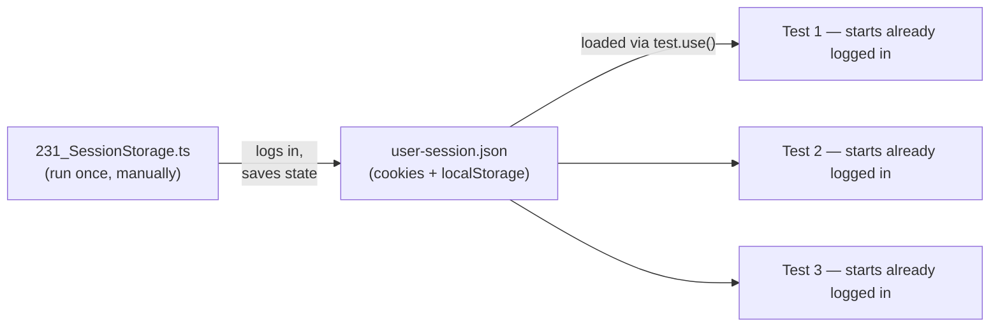
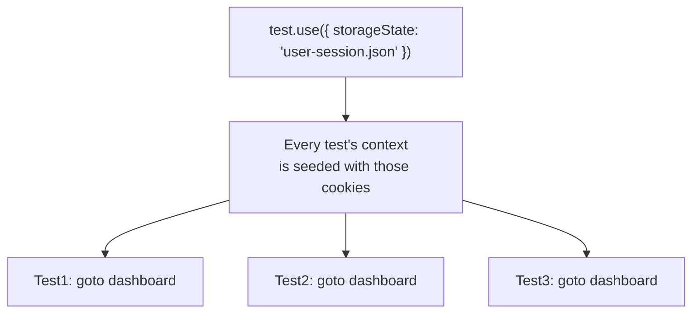

# 04_Session_Storage — Notes

Notes for everything covered in `tests/04_Session_Storage/`. Diagrams are in Mermaid
(renders natively on GitHub and in VS Code's Markdown preview).

## File map

| File | Concept it teaches |
|---|---|
| `231_SessionStorage.ts` | Log in once (raw library script), save the session to disk |
| `232_TestWingify.spec.ts` | Reuse the saved session in every test — skip the login UI entirely |

---

## 1. The problem: logging in before every test is slow

Without saved sessions, any test behind auth has to repeat the full login flow — fill
email, fill password, click submit, wait for redirect — before it can test anything else.
Multiply that by dozens of tests and most of your suite's time is spent re-doing the same
login over and over.

**The fix:** log in **once**, save the resulting cookies/localStorage to a JSON file, and
have every other test load that file instead of logging in.



---

## 2. Saving the session

`231_SessionStorage.ts` is a raw library script (not a spec — notice it's `.ts`, not
`.spec.ts`, so `npx playwright test` won't pick it up; run it directly with `npx tsx` or
`ts-node`):

```ts
let browser = await chromium.launch({ headless: false });
let context = await browser.newContext();
let page = await context.newPage();

await page.goto("https://app.wingify.com/#/login");
await page.fill("#login-username", VWO_USER);
await page.fill("#login-password", VWO_PASS);
await page.click("#js-login-btn");
await page.waitForURL(/#\/(dashboard|home)/, { timeout: 15000 });

await context.storageState({ path: "./user-session.json" });
```

`context.storageState({ path })` dumps that context's cookies and localStorage to a JSON
file. `page.waitForURL(...)` is what makes this safe to run unattended — it blocks until
the post-login redirect actually happens, so the session is only saved once login
genuinely succeeded.

---

## 3. Never hardcode credentials

The login credentials come from environment variables, not literals in the file:

```ts
function requireEnv(name: string): string {
  const value = process.env[name];
  if (!value) {
    throw new Error(`${name} must be set in .env (see .env.example)`);
  }
  return value;
}

const VWO_USER = requireEnv('VWO_USER');
const VWO_PASS = requireEnv('VWO_PASS');
```

- `dotenv.config()` loads `.env` (already in `.gitignore` — confirmed) into
  `process.env` at the top of the script.
- `requireEnv` fails **loudly and immediately** if a variable is missing, instead of
  silently filling `undefined` into the login form (which would just hang or produce a
  confusing failure deep inside Playwright).

**Gap to fill in later:** the error message points to `.env.example`, but that file
doesn't exist in the repo yet — worth adding one (with `VWO_USER=` / `VWO_PASS=` and no
real values) so anyone cloning the repo knows what to put in their own `.env`.

---

## 4. Reusing the session in tests

`232_TestWingify.spec.ts` loads the saved file via `test.use()` at the top of the file —
this applies to **every test in that file** (or inside a `describe` block, if placed
there instead):

```ts
test.use({
  storageState: './user-session.json',
  screenshot: 'only-on-failure',
});

test("go directly to dashboard — Test1", async ({ page }) => {
  await page.goto("https://app.wingify.com/#/dashboard?accountId=1281316");
  await expect(page).toHaveURL(/dashboard/);
  // no login step at all — the context already has valid cookies
});
```

Three near-identical tests in this file all benefit from the same saved session —
none of them touch the login form.



---

## 5. The catch: sessions expire

A saved `storageState` is a **snapshot**, not a live login — if the real session/cookie
has a TTL and it lapses, tests using the stale file will suddenly land back on the login
page for no obvious reason. When that happens, the fix is simple: re-run
`231_SessionStorage.ts` to regenerate `user-session.json`, not to debug the spec files.

For a long-lived suite, some teams automate this regeneration (e.g. a Playwright
**global setup** function that runs the login once before the whole run, instead of a
script you remember to re-run by hand) — worth considering once this session expires
often enough to be annoying.

---

## Quick recap

| Concept | One-line rule of thumb |
|---|---|
| `context.storageState({ path })` | Dumps cookies + localStorage to a JSON file |
| `test.use({ storageState: path })` | Every test in that file/describe starts with that state already loaded |
| Credentials | Env vars via `.env` + a fail-fast `requireEnv()` helper — never literals in the file |
| `.gitignore` | `user-session.json` and `*storage*.json` are already excluded — don't commit real sessions |
| Session goes stale | Re-run the save script; consider a `globalSetup` for long-lived suites |
