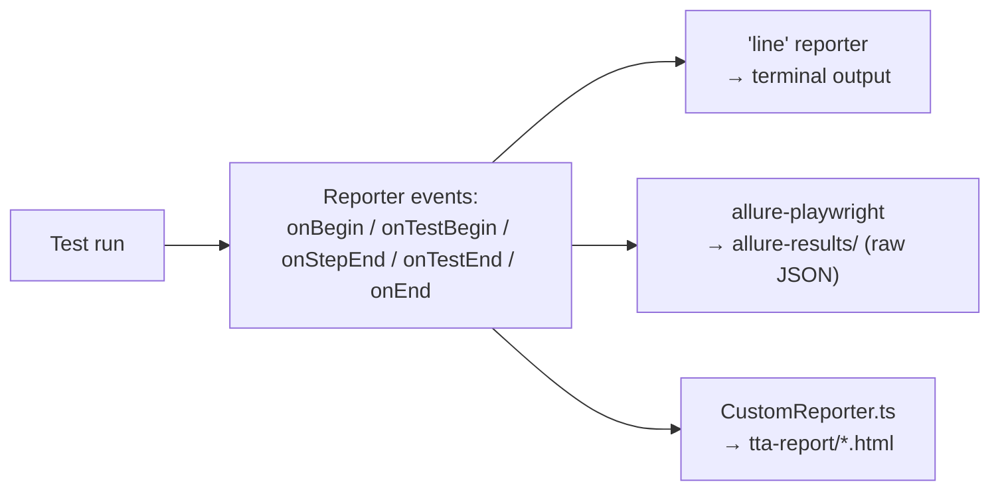
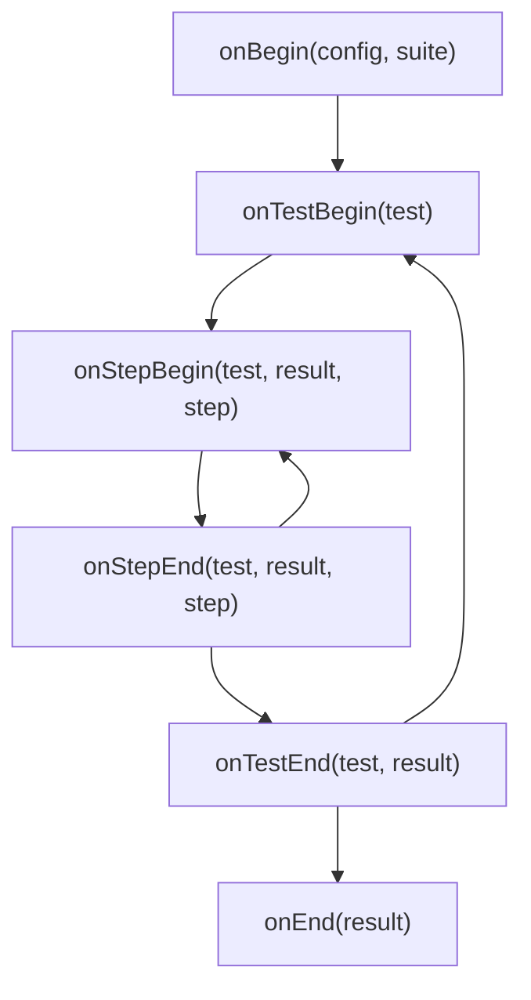

# 05_Allure_Reporting — Notes

Notes for everything covered in `tests/05_Allure_Reporting/` plus the reporter wiring in
`playwright.config.ts` and `utils/CustomReporter.ts`. Diagrams are in Mermaid (renders
natively on GitHub and in VS Code's Markdown preview).

## File map

| File | Concept it teaches |
|---|---|
| `232_TestWingify.spec.ts` | Baseline: the same saved-session dashboard checks from topic 04, now feeding the reporters below |
| `233_Custom_Report_TestWingify.spec.ts` | Same checks again — an iteration while wiring up the custom reporter (near-duplicate of 232, worth merging later) |
| `234_Media_Custom_Report.spec.ts` | Same checks with `screenshot`/`video`/`trace` all forced **on**, plus `test.step()` + `testInfo.attach()`, so the custom reporter has real media to render |
| `utils/CustomReporter.ts` | A hand-written `Reporter` implementation that builds a self-contained HTML report |
| `playwright.config.ts` (`reporter: [...]`) | Running **three reporters at once**: `line`, `allure-playwright`, and the custom one |

---

## 1. Playwright supports multiple reporters at once

```ts
reporter: [["line"], ["allure-playwright"], ["./utils/CustomReporter.ts"]],
```

Each entry gets the *same* stream of events (test started, step finished, test ended,
run ended) — they don't interfere with each other. `line` prints a compact one-line-per-test
log to the terminal; `allure-playwright` and the custom reporter each build their own report
on disk.



---

## 2. Allure: two-step reporting

`allure-playwright` only writes **raw result files** (`allure-results/`) during the test
run — it does not render the pretty HTML report itself. That's a separate step using the
`allure-commandline` package (already a dependency):

```bash
npx allure generate ./allure-results --clean -o ./allure-report
npx allure open ./allure-report
# or, for local use: npx allure serve ./allure-results
```

**Gap to fill in later:** none of these `allure` commands are in `package.json` `scripts`
yet — worth adding `"allure:report": "allure generate ./allure-results --clean && allure open"`
so the Allure half of this topic is actually runnable with one `npm run` command, the same
way `npm run report` already works for Playwright's own HTML report.

---

## 3. Writing your own reporter

`utils/CustomReporter.ts` implements Playwright's `Reporter` interface
(`@playwright/test/reporter`) directly, instead of using a pre-built one. The lifecycle
hooks it uses:



- **`onTestBegin`** — records the start time and which `describe` blocks a test is nested
  under (walking up `test.parent` to rebuild the full suite path).
- **`onStepEnd`** — every `test.step(...)` block fires this; the reporter captures its
  title, duration, pass/fail, and matches up any console logs for that step.
- **`onTestEnd`** — pulls out everything attached to the test's `result.attachments`
  (screenshots, videos, traces — anything added via `testInfo.attach()`), copies them into
  `tta-report/`, and stores one `TestData` record.
- **`onEnd`** — writes the final HTML file once the whole run is done.

This is the same general shape any custom reporter follows — only the hooks you actually
need have to do anything (a minimal reporter might only implement `onTestEnd` and `onEnd`).

---

## 4. `test.step()` — structuring a test for any reporter

`234_Media_Custom_Report.spec.ts` wraps each logical action in a named step:

```ts
await test.step('open the dashboard', async () => {
  await page.goto(DASHBOARD);
  await expect(page).toHaveURL(/dashboard/);
});

await test.step('confirm we are not on the login screen', async () => {
  await expect(page.locator('#login-username')).toBeHidden();
});
```

Steps show up as a nested breakdown in Playwright's own HTML report, in Allure, **and**
in the custom reporter here — it's a one-time investment that pays off in every reporter
you ever add, instead of one flat "test passed/failed" line.

---

## 5. `testInfo.attach()` — the generic way to add evidence

```ts
await testInfo.attach(`dashboard-test${n}`, {
  body: await page.screenshot({ fullPage: true }),
  contentType: 'image/png',
});
```

Anything attached this way — screenshots, JSON blobs, plain text — ends up in
`result.attachments` for every reporter to read. `CustomReporter.ts` specifically looks
for a few attachment names it treats specially: `self-heal` (JSON), `ai-data` (JSON), and
any `image/png`/`video/webm` attachment, plus the automatic `trace` attachment.

---

## 6. Capturing media has a cost

`234_Media_Custom_Report.spec.ts` forces media on for every test, pass or fail:

```ts
test.use({
  storageState: './user-session.json',
  screenshot: 'on',   // vs. the project default: 'only-on-failure'
  video: 'on',        // vs. default: off
  trace: 'on',        // vs. this repo's config default: 'on-first-retry'
});
```

This is deliberately heavier than normal so the custom reporter has something to show —
fine for this one demo file, but turning all three on for a whole suite will noticeably
slow it down and bloat `test-results/`. For everyday suites, prefer the lighter defaults
(`screenshot: 'only-on-failure'`, `trace: 'on-first-retry'`, video off) and only dial media
up when actively debugging or building a report like this one.

---

## 7. Beyond Allure: the reporter also has AI-oriented tabs

Reading `CustomReporter.ts` in full, it goes further than a typical Allure-style report —
it has extra tabs for **AI Verdict** (root-cause analysis of failures via an LLM),
**Flaky** (comparing pass/fail status build-over-build), and **Self-Heal** (suggested
locator replacements when a selector stops resolving). Those are powered by
`ai/agents/rcaAgent` and `ai/agents/flakyAnalyzer`, and by the `HealReport` shape in
`utils/selfHeal.ts`.

That's forward-looking material closer to topic **22 (Misc AI Concepts)** than to
"Allure Reporting" — noted here because the same file wires it in, but worth its own notes
file once that topic is actually reached, rather than expanding on it in this one.

---

## Quick recap

| Concept | One-line rule of thumb |
|---|---|
| Multiple reporters | Pass an array to `reporter: [...]` — each gets every event independently |
| `allure-playwright` | Writes raw results only — still need `allure generate`/`allure open` to view them |
| Custom reporter | Implement `Reporter` from `@playwright/test/reporter`; only hook what you need |
| `test.step()` | Structures a test for *every* reporter at once — cheap, worth doing by default |
| `testInfo.attach()` | Generic way to hand any reporter a screenshot/JSON/text blob |
| Always-on media | Useful for a demo/report-building file; too heavy for a normal everyday suite |
