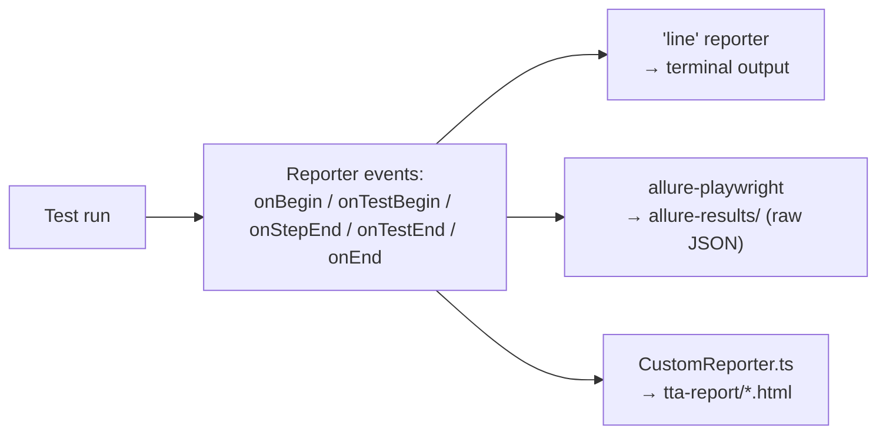
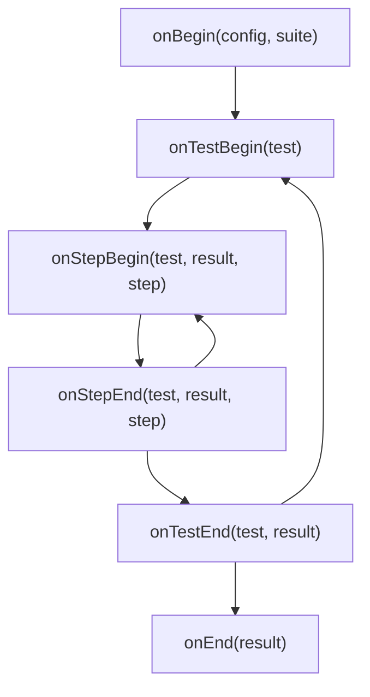
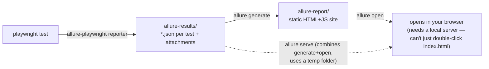
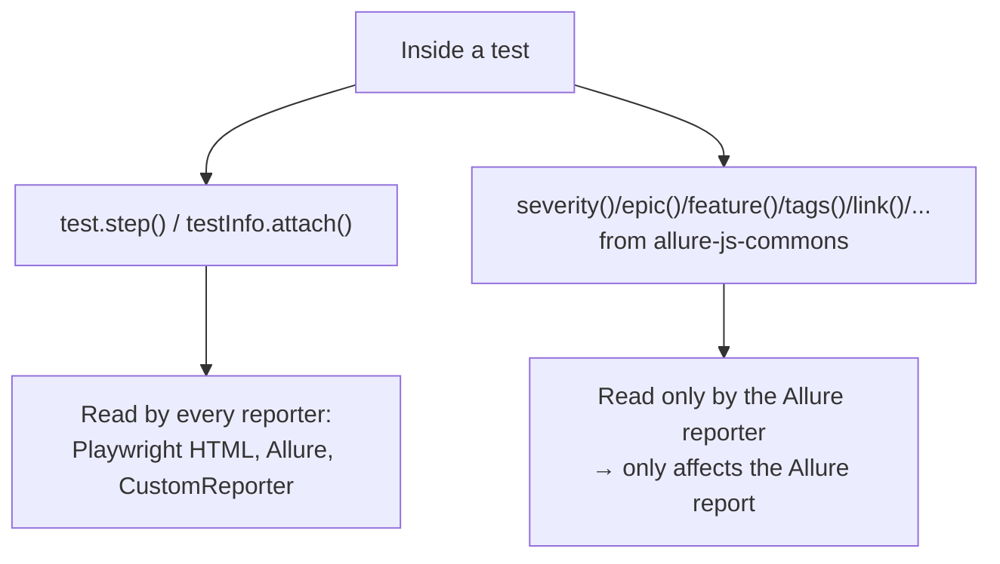
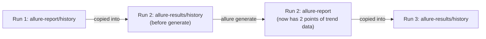

# 05_Allure_Reporting — Notes

Two parts: **Part A** documents what's actually in `tests/05_Allure_Reporting/` today
(which only wires Allure in as a reporter, nothing more). **Part B** is a full lesson on
Allure itself — the annotation API, categories, history trends, CLI — none of which your
current files use yet, so Part A alone would teach "how to turn Allure on," not "how Allure
works." Diagrams are in Mermaid (renders natively on GitHub and in VS Code's preview).

## File map

| File | Concept it teaches |
|---|---|
| `232_TestWingify.spec.ts` | Baseline: the same saved-session dashboard checks from topic 04, now feeding the reporters below |
| `233_Custom_Report_TestWingify.spec.ts` | Same checks again — an iteration while wiring up the custom reporter (near-duplicate of 232, worth merging later) |
| `234_Media_Custom_Report.spec.ts` | Same checks with `screenshot`/`video`/`trace` all forced **on**, plus `test.step()` + `testInfo.attach()`, so the custom reporter has real media to render |
| `utils/CustomReporter.ts` | A hand-written `Reporter` implementation that builds a self-contained HTML report |
| `playwright.config.ts` (`reporter: [...]`) | Running **three reporters at once**: `line`, `allure-playwright`, and the custom one |

---

# Part A — What your files do today

## A1. Playwright supports multiple reporters at once

```ts
reporter: [["line"], ["allure-playwright"], ["./utils/CustomReporter.ts"]],
```

Each entry gets the *same* stream of events (test started, step finished, test ended,
run ended) — they don't interfere with each other. `line` prints a compact one-line-per-test
log to the terminal; `allure-playwright` and the custom reporter each build their own report
on disk.



## A2. Writing your own reporter

`utils/CustomReporter.ts` implements Playwright's `Reporter` interface
(`@playwright/test/reporter`) directly, instead of using a pre-built one:



- **`onTestBegin`** — records the start time and which `describe` blocks a test is nested under.
- **`onStepEnd`** — every `test.step(...)` block fires this; captures title, duration, pass/fail.
- **`onTestEnd`** — pulls everything out of `result.attachments` (screenshots, videos, traces),
  copies them into `tta-report/`, stores one `TestData` record.
- **`onEnd`** — writes the final HTML file once the whole run is done.

Only the hooks you actually need have to do anything — a minimal reporter might implement
just `onTestEnd` and `onEnd`.

## A3. `test.step()` and `testInfo.attach()` — structuring a test for any reporter

```ts
await test.step('open the dashboard', async () => {
  await page.goto(DASHBOARD);
  await expect(page).toHaveURL(/dashboard/);
});

await testInfo.attach(`dashboard-test${n}`, {
  body: await page.screenshot({ fullPage: true }),
  contentType: 'image/png',
});
```

Steps and attachments show up in Playwright's own HTML report, in Allure, **and** in the
custom reporter — structuring a test this way is a one-time cost that pays off in every
reporter you ever add.

## A4. Capturing media has a cost

```ts
test.use({
  storageState: './user-session.json',
  screenshot: 'on',   // vs. the project default: 'only-on-failure'
  video: 'on',        // vs. default: off
  trace: 'on',        // vs. this repo's config default: 'on-first-retry'
});
```

`234_Media_Custom_Report.spec.ts` forces all three on so the custom reporter has media to
render. Fine for one demo file; turning all three on for a whole suite will noticeably slow
it down and bloat `test-results/`. For everyday suites, keep the lighter defaults and only
dial media up when actively debugging.

## A5. Beyond Allure: the custom reporter also has AI-oriented tabs

`CustomReporter.ts` goes further than a typical Allure-style report — it has extra tabs for
**AI Verdict** (LLM root-cause analysis), **Flaky** (build-over-build comparison), and
**Self-Heal** (suggested locator replacements), powered by `ai/agents/rcaAgent`,
`ai/agents/flakyAnalyzer`, and `utils/selfHeal.ts`. That's forward-looking material closer
to topic **22 (Misc AI Concepts)** — noted here because the same file wires it in, but it
deserves its own notes once that topic is actually reached.

---

# Part B — Allure, properly

## B1. What Allure actually is, and why bother

Playwright's built-in HTML report is already good. Allure adds things that matter once a
suite is run regularly by more than one person:

- **Trend graphs** across runs (pass rate, duration, flaky count over time) — Playwright's
  HTML report only ever shows the *last* run.
- **Categorization** of failures into your own buckets ("Product defect" vs "Test defect"
  vs "Environment issue") instead of just pass/fail.
- **BDD-style grouping** (epic → feature → story) so a report reads like a feature map, not
  a flat file list — useful once a suite is big enough that "all tests in `tests/`" stops
  being a meaningful grouping.
- **A framework-agnostic format** — the same Allure report style works for Playwright,
  Cypress, JUnit, pytest, Cucumber, etc. If your org runs multiple test frameworks, Allure
  gives them all the same report shape.
- **Environment & history panels** baked in, without writing any of the HTML yourself
  (contrast with `CustomReporter.ts`, which hand-builds its own HTML for this).

None of that shows up by just adding `"allure-playwright"` to the reporter array, the way
this repo currently has it — that only gets you the raw data. Everything above needs the
pieces in B3–B6.

## B2. The two-artifact pipeline (expanded)



```bash
# the two-step, explicit way (what you'd use in CI)
npx allure generate ./allure-results --clean -o ./allure-report
npx allure open ./allure-report

# the one-step, local-only convenience way
npx allure serve ./allure-results
```

`allure generate` reads every JSON file in `allure-results/` and renders them into one
static site. `--clean` wipes `allure-report/` first so results from a previous unrelated
run don't linger. `allure open` just starts a tiny local server pointed at that folder —
Allure's report uses `fetch()` to load its data files, which browsers block under
`file://`, so you can't just open `allure-report/index.html` directly.

**Gap to fill in later:** add these to `package.json` so this is one command, not three to
remember:

```json
"scripts": {
  "allure:generate": "allure generate ./allure-results --clean -o ./allure-report",
  "allure:open": "allure open ./allure-report",
  "allure:report": "npm run allure:generate && npm run allure:open",
  "allure:serve": "allure serve ./allure-results"
}
```

## B3. The annotation API — the part your tests don't use yet

`allure-playwright` (v3, what's installed here — checked `node_modules/allure-playwright/dist/types/index.d.ts`
directly) **deprecates** its old `import { allure } from "allure-playwright"` object. The
current API is a set of standalone functions imported from `allure-js-commons` instead
(confirmed against `node_modules/allure-js-commons/dist/types/facade.d.ts`). None of
`232`/`233`/`234` import this yet — right now Allure only knows a test's title, status,
duration, and whatever Playwright attachments/steps it already captures.

```ts
import { epic, feature, story, severity, owner, tags, link, issue, description } from "allure-js-commons";

test("go directly to dashboard — Test1", async ({ page }) => {
  // BDD-style grouping: shows up as a filterable tree in the Allure report
  await epic("Wingify Dashboard");
  await feature("Session reuse");
  await story("Dashboard loads without re-login");

  // how bad is it if this fails?
  await severity("critical"); // blocker | critical | normal | minor | trivial

  // free-form metadata
  await owner("Pratik Rajpure");
  await tags("smoke", "dashboard");       // plural = multiple at once; tag(name) = one at a time
  await link("https://app.wingify.com", "Wingify app");
  await issue("https://github.com/you/repo/issues/42", "JIRA-42");

  // markdown description, shown at the top of the test's report page
  await description("Confirms a saved session skips login on first load.");

  await page.goto("https://app.wingify.com/#/dashboard?accountId=1281316");
  await expect(page).toHaveURL(/dashboard/);
});
```

| Call | What it does in the report |
|---|---|
| `epic(name)` / `feature(name)` / `story(name)` | Three-level BDD grouping — filter the whole report by any level |
| `severity(name)` | Color-coded severity badge; filterable; feeds the severity-breakdown chart |
| `tag(name)` / `tags(...names)` | Free-form labels, filterable, shown as chips on the test |
| `owner(name)` | Who's responsible — groups/filters by owner |
| `link(url, name?, type?)` / `issue(url, name?)` / `tms(url, name?)` | Clickable links to a page, a bug tracker issue, or a test-management-system case |
| `description(markdown)` / `descriptionHtml(html)` | Markdown/HTML write-up on the test's detail page |
| `parameter(name, value, options?)` | Shows input parameters — useful for data-driven tests (topic 19) |
| `step(name, body)` | An Allure-specific nested step (works like `test.step`, but Allure-only) |
| `attachment(name, content, type)` / `attachmentPath(name, path, type)` | Attach a screenshot/JSON/text blob directly via the Allure API, instead of `testInfo.attach` |
| `displayName(name)` | Override the title shown in the Allure report only |

**Practical note:** you don't have to choose between `test.step`/`testInfo.attach` (Part A)
and these `allure-js-commons` calls — they're complementary. `test.step`/`testInfo.attach`
feed *every* reporter (Playwright's own HTML, Allure, your custom one). The functions above
only add Allure-specific metadata (severity, epic/feature/story, links) that nothing else
reads. Use both: structure/evidence via `test.step`/`attach`, classification/organization
via the functions above.



## B4. Categories — classifying *why* something failed

By default every failure is just "failed," with Playwright's raw error message. Allure lets
you define your own buckets by dropping a `categories.json` into `allure-results/` before
running `allure generate`:

```json
[
  {
    "name": "Product defects",
    "matchedStatuses": ["failed"],
    "messageRegex": ".*AssertionError.*"
  },
  {
    "name": "Test defects",
    "matchedStatuses": ["broken"],
    "messageRegex": ".*(TimeoutError|Cannot find module).*"
  },
  {
    "name": "Environment issues",
    "matchedStatuses": ["broken"],
    "messageRegex": ".*(net::ERR_|ECONNREFUSED).*"
  }
]
```

Allure matches each failure's status + error message against these rules and groups them
under your category names in the report's "Categories" tab — instead of a flat list of 50
failures, you see "3 Product defects, 40 Environment issues, 7 Test defects" at a glance.
This file can be copied in automatically from a fixed location as part of your test script
or CI step (e.g. `cp allure-categories.json allure-results/categories.json` right before
`allure generate`).

## B5. Environment info panel

Drop an `environment.properties` file into `allure-results/` (plain key=value, Java-properties
style) and Allure renders an "Environment" panel on the report's overview page:

```properties
Browser=Chromium
Base.URL=https://app.wingify.com
Node.Version=20.19.1
CI=false
```

Useful for answering "wait, which environment did this run against?" without digging
through CI logs. In this repo, a small script (or a `globalSetup` in `playwright.config.ts`)
could generate this automatically from `process.env` / `process.version` right before the
suite starts.

## B6. History & trend graphs across runs

The "Trend," "Duration," and "Retries" graphs on Allure's overview page need history data —
and by default, each `allure generate` starts from zero because `--clean` wipes the report
folder, history included. The fix: carry the previous report's `history/` folder into the
*next* run's `allure-results/` before generating:

```bash
# before generating the new report, seed history from the previous one
cp -r allure-report/history allure-results/history 2>/dev/null || true

npx allure generate ./allure-results --clean -o ./allure-report
```



In CI this usually means caching/restoring the `allure-report/history` folder between
pipeline runs (as a build artifact or cache key) — without that step, trend graphs never
accumulate more than one data point no matter how many times the suite runs.

## B7. CLI command reference

| Command | What it does |
|---|---|
| `allure generate <results-dir> -o <report-dir>` | Build the static HTML report from raw results |
| `allure generate ... --clean` | Wipe `<report-dir>` first (don't mix with a stale previous report) |
| `allure open <report-dir>` | Serve a previously generated report locally |
| `allure serve <results-dir>` | Generate into a temp dir **and** open it, in one step — handiest for local dev |
| `allure --version` | Sanity-check the CLI is on PATH (it's resolved here via the `allure-commandline` npm dependency) |

## B8. Playwright HTML vs Allure vs the custom reporter — when to reach for which

| Need | Best fit |
|---|---|
| Quick local debugging of the last run (traces, screenshots, step timeline) | Playwright's own HTML report (`npm run report`) |
| Trends across many runs, severity/owner/epic filtering, shareable with non-engineers | Allure |
| Something *this specific org* needs that neither gives you (AI root-cause, flaky-across-builds, self-heal suggestions) | A custom reporter, like `CustomReporter.ts` |
| CI artifact that's just "did it pass, what failed" | Any of the three — `line` reporter is often enough for CI logs alone |

They're not mutually exclusive — this repo already proves that by running all three from
one `reporter: [...]` array.

---

## Try it yourself (so this actually sticks)

1. Add `severity`, `epic`/`feature`/`story`, and `tags` calls (from `allure-js-commons`) to
   `234_Media_Custom_Report.spec.ts`, then run it and `npx allure serve ./allure-results` —
   watch how the report's sidebar changes shape.
2. Add the four `allure:*` scripts from B2 to `package.json`.
3. Write a `categories.json` with at least one real category that matches an error your
   own tests could actually throw (e.g. a `TimeoutError` category), drop it into
   `allure-results/` before generating, and confirm a failing test lands in that bucket.
4. Run the suite twice in a row, carrying `history/` forward between runs (B6), and confirm
   the Trend graph shows two data points instead of one.

---

## Quick recap

| Concept | One-line rule of thumb |
|---|---|
| Multiple reporters | Pass an array to `reporter: [...]` — each gets every event independently |
| `allure-playwright` (as configured today) | Writes raw results only — still need `allure generate`/`allure open` to view them |
| `allure-js-commons` functions | Call them *inside* tests to add severity/epic/feature/tags/links — nothing shows these by default |
| `categories.json` | Classify failures into your own buckets instead of a flat pass/fail list |
| `environment.properties` | Shows a fixed environment info panel on the report overview |
| History folder | Must be carried forward manually between `generate` runs, or trend graphs never grow |
| Custom reporter | Implement `Reporter` from `@playwright/test/reporter`; only hook what you need |
| `test.step()` / `testInfo.attach()` | Feed *every* reporter at once — cheap, worth doing by default |
