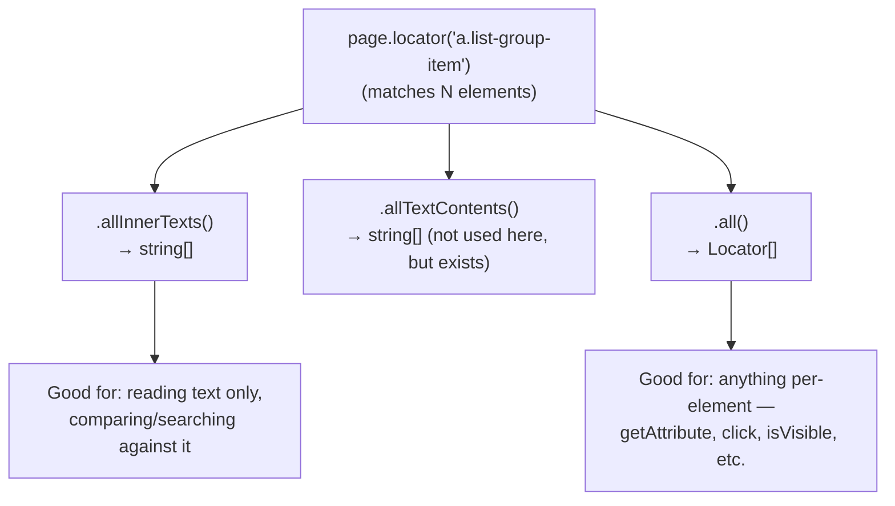
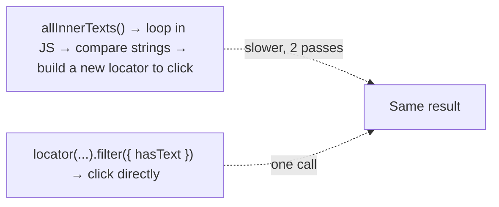

# 06_Multiple_Element_Filter — Notes

Notes for everything covered in `tests/06_Multiple_Element_Filter/`. Diagrams are in
Mermaid (renders natively on GitHub and in VS Code's Markdown preview).

## File map

| File | Concept it teaches |
|---|---|
| `235_ME.spec.ts` | `.allInnerTexts()` to read every match's text at once, then find-and-click by matching text in a loop |
| `236_ME.spec.ts` | `.all()` — an array of individual `Locator`s, so you can read a *different* property (`href`) per element |

---

## 1. Two ways to pull data out of a locator that matches many elements

A locator like `page.locator('a.list-group-item')` can match 10+ links at once. Both files
start from that same locator, but ask it for different things:

```ts
// 235: just the visible text of every match, as plain strings — fast, one call
const texts: string[] = await page.locator('a.list-group-item').allInnerTexts();

// 236: the actual Locator objects, one per match — lets you call .getAttribute(), .click(), etc. on each
const links: Locator[] = await page.locator('a.list-group-item').all();
for (const link of links) {
  console.log(await link.getAttribute('href'));
}
```



**Rule of thumb:** if you only need the *text* of every match, `.allInnerTexts()` (or its
sibling `.allTextContents()` — same idea, but reads `textContent` instead of the rendered
`innerText`, so it also picks up text hidden by CSS) is the one-line answer. The moment you
need anything else per element — an attribute, a click, a visibility check — you need the
actual `Locator` objects from `.all()`, because a plain string has no such methods.

---

## 2. Find-and-click by matching text (the manual way)

`235_ME.spec.ts` finds "Forgotten Password" by looping over every link's text and comparing:

```ts
const rightPanelLinksTexts: string[] = await page.locator('a.list-group-item').allInnerTexts();

for (const linkText of rightPanelLinksTexts) {
  if (linkText === "Forgotten Password") {
    await page.getByText(linkText).first().click();
  }
}
```

This works, but it's doing two passes (read all text, then search it in JS) and builds a
**brand new locator** (`page.getByText(linkText)`) inside the loop instead of reusing the
one you already had. Topic 07 (`239_TestCase.spec.ts`) shows the more idiomatic one-liner
for the exact same goal:

```ts
await page.locator('a.list-group-item').filter({ hasText: 'Forgotten Password' }).click();
```

`.filter({ hasText })` narrows the *existing* locator down to the matching element(s)
directly — no manual loop, no re-querying the DOM in JavaScript. Worth comparing these two
files side by side as "the loop-and-compare way" vs. "the built-in filter way."



---

## Quick recap

| Need | Reach for |
|---|---|
| Text of every match, nothing else | `.allInnerTexts()` / `.allTextContents()` |
| An attribute/action on *each* match individually | `.all()` → loop over `Locator[]` |
| Find the one match with specific text | `.filter({ hasText: '...' })` — not a manual loop + `getByText` |
| How many elements matched | `.count()` (not used here yet, but the natural partner to `.all()`) |
