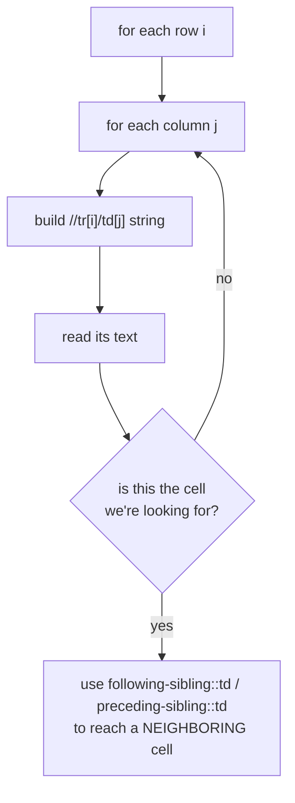
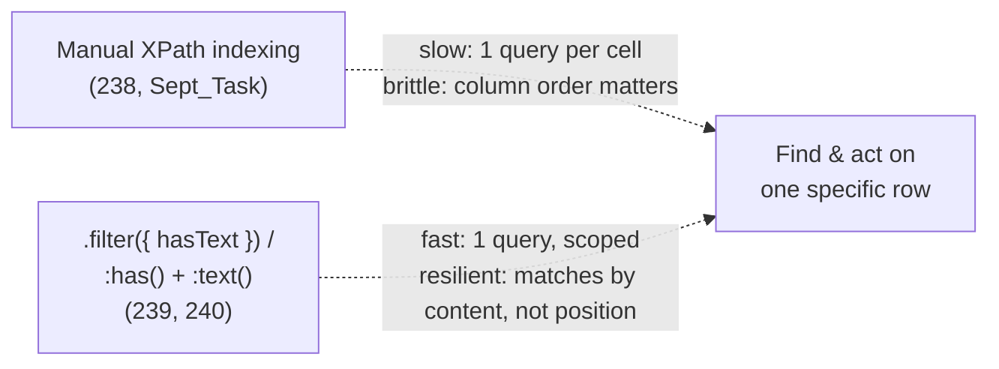
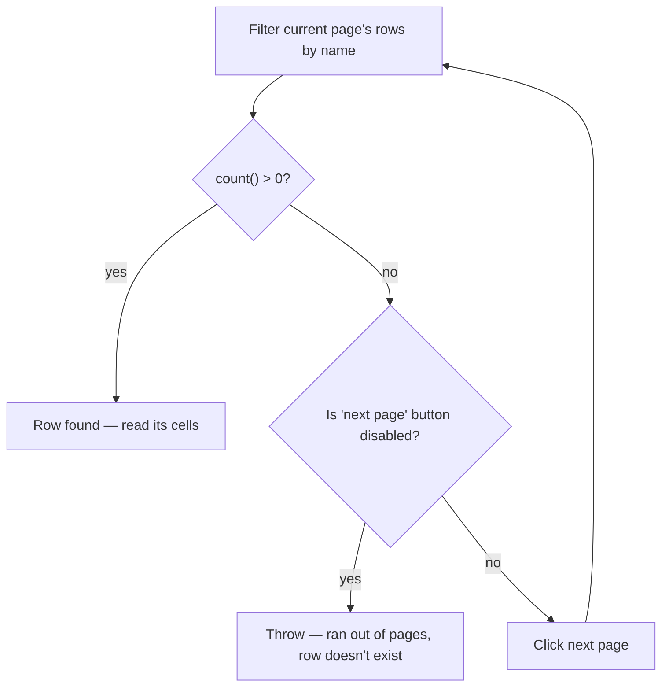

# 07_WebTables — Notes

Notes for everything covered in `tests/07_WebTables/`. The files in this folder read like a
progression — start brute-force (manual row/column indexing), end idiomatic (`.filter()` +
scoped locators) — so these notes follow that same order rather than file-name order.
Diagrams are in Mermaid (renders natively on GitHub and in VS Code's preview).

## File map

| File | Concept it teaches |
|---|---|
| `236_WebTable.spec.ts` | ⚠️ Unfinished placeholder — see note below |
| `237_TestCase.spec.ts` | Count rows with `.count()`, loop with `.nth(i)` to read each row |
| `238_TestCase.spec.ts` | Manual XPath cell-by-cell indexing (`tr[i]/td[j]`), `following-sibling::td` |
| `Sept_Task.spec.ts` | Same manual-indexing technique, clicking a `preceding-sibling::td` checkbox |
| `239_TestCase.spec.ts` | The cleaner way: `.filter({ hasText })` to find a row/link directly |
| `240_TestCase.spec.ts` | `:has()` + `:text()` CSS — scoped-locator alternative to XPath siblings |
| `241_WebTable_Pagination.spec.ts` | Searching for a row across paginated results |
| `242_WebTable_Pagination.spec.ts` | Same pagination search, refactored into a reusable function |

---

## 1. ⚠️ `236_WebTable.spec.ts` is an unfinished placeholder

```ts
test('Verify the TestCase', async ({ page }) => {
   await page.goto("https://app.thetestingacademy.com/playwright/multiple_element_filter");
    // Code
   await page.pause();
});
```

This is identical to `template/template.spec.ts` — it's the boilerplate starter, not yet
filled in, and it even points at the *multiple_element_filter* page rather than a table.
Worth either deleting it or filling it in with an actual table exercise so the file map
here doesn't have a dead entry.

---

## 2. Counting and iterating rows the straightforward way

`237_TestCase.spec.ts`:

```ts
const rows = page.locator('table[summary="Sample Table"] tbody tr');
const rowCount = await rows.count();

for (let i = 0; i < rowCount; i++) {
  const rowsData = await rows.nth(i).locator('td').allInnerTexts();
  console.log(`Row ${i + 1}:`, rowsData);
}
```

`.count()` tells you how many rows matched; `.nth(i)` scopes down to one specific row,
and `.locator('td')` + `.allInnerTexts()` (from topic 06) reads every cell's text in that
one row as an array. This is the baseline pattern most table-reading code builds on.

---

## 3. The brute-force alternative: manual XPath indexing

`238_TestCase.spec.ts` and `Sept_Task.spec.ts` instead build an XPath string by hand for
*every single cell*, looping over row and column numbers:

```ts
const firstPart = "//table[@id='customers']/tbody/tr[";
const secondPart = "]/td[";
const thirdPart = "]";

for (let i = 2; i <= rows; i++) {
  for (let j = 1; j <= cols; j++) {
    const dynamicPath = `${firstPart}${i}${secondPart}${j}${thirdPart}`;
    const data = await page.locator(dynamicPath).innerText();
    if (data.includes('Helen Bennett')) {
      const countryPath = `${dynamicPath}/following-sibling::td`;
      const countryText = await page.locator(countryPath).innerText();
    }
  }
}
```



**Why this exists despite being verbose:** `following-sibling::td` (next cell in the same
row) and `preceding-sibling::td[1]` (`Sept_Task.spec.ts`, the checkbox cell *before* the
matched one) are genuinely things plain CSS cannot express at all — CSS has no "previous
sibling" selector, and `following-sibling` in XPath is more general than CSS's `~`
(general sibling) combinator. See `notes/03_Locator_Commands.md` Part B4 for the full
CSS-vs-XPath breakdown — this is exactly the kind of case that note calls out.

**The real cost of this approach:** it re-queries the DOM `rows × cols` times (one
`.locator().innerText()` call per cell), and it breaks the moment a column is
added/reordered, because `td[2]` silently starts meaning something else. It's correct, but
it's the least resilient and slowest technique in this folder — section 4 shows why the
rest of the files move away from it.

---

## 4. The idiomatic way: filter to the row, then read within it

`239_TestCase.spec.ts` shows the one-line version of "find the thing with this text":

```ts
const forgottenPasswordLink = page.locator('a.list-group-item').filter({ hasText: 'Forgotten Password' });
await forgottenPasswordLink.click();
```

`240_TestCase.spec.ts` applies the same idea to a table row, combining it with Playwright's
CSS extensions (`notes/03_Locator_Commands.md` Part B3) instead of XPath:

```ts
await page.locator("tr:has(td:text('Rohan.Mehta'))")
  .locator('input')
  .first()
  .click();
```

`tr:has(td:text('Rohan.Mehta'))` reads as "a `<tr>` that contains a `<td>` whose text is
Rohan.Mehta" — one locator, no loop, no manual string-building, and it keeps working if the
table gains or loses columns (since it isn't counting column positions at all). The file
even has the XPath equivalent commented out directly above it for comparison:

```ts
// await page.locator('//td[text()="Rohan.Mehta"]/preceding-sibling::td/input').click();
```

Same goal, two techniques — worth reading both lines back to back.



---

## 5. Searching across pagination

`241_WebTable_Pagination.spec.ts` handles a table that's split across multiple pages —
the row you want might not be on the current page yet:

```ts
let row;
while (true) {
  row = page.locator('#employees-tbody tr').filter({ hasText: name });
  if (await row.count()) {
    break;                                    // found it on this page
  }
  const next = page.getByTestId('next-page');
  if (await next.isDisabled()) {
    throw new Error("Row not found!");          // ran out of pages
  }
  await next.click();
}

const email = await row.locator('td[data-col="email"]').innerText();
```



Two things make this safe to leave unattended: checking `.count()` (not throwing if it's
zero — zero just means "not on this page yet") and checking the *next* button's disabled
state as the loop's actual exit condition, so it can't spin forever on a table that
genuinely doesn't contain the row.

`242_WebTable_Pagination.spec.ts` is the same logic, pulled out into a reusable function:

```ts
async function findRowByName(page: Page, name: string): Promise<Locator> {
  while (true) {
    const row = page.locator('#employees-tbody tr').filter({ hasText: name });
    if (await row.count()) return row;
    const next = page.getByTestId('next-page');
    if (await next.isDisabled()) throw new Error(`Row not found: ${name}`);
    await next.click();
  }
}
```

**Why 242 is worth keeping over 241:** the moment a second test needs "find this row across
pages," 241's version has to be copy-pasted; 242's version is just `await findRowByName(page, 'X')`.
Same logic, reusable the second time it's needed — a good example of when to extract a
helper and when not to bother (241 on its own, as a one-off, would've been fine too).

---

## Quick recap

| Need | Reach for |
|---|---|
| How many rows matched | `.count()` |
| One specific row by position | `.nth(i)` |
| Every cell's text in one row | `.locator('td').allInnerTexts()` |
| A neighboring cell (next/previous), no CSS equivalent | XPath `following-sibling::` / `preceding-sibling::` |
| Find a row by its content, not its position | `.filter({ hasText })` or CSS `:has()` + `:text()` — prefer this over manual indexing |
| Row might be on a different page | Loop: filter → check count → check "next" disabled → click next |
| Same pagination search needed more than once | Extract it into a helper function, like `242`'s `findRowByName` |
