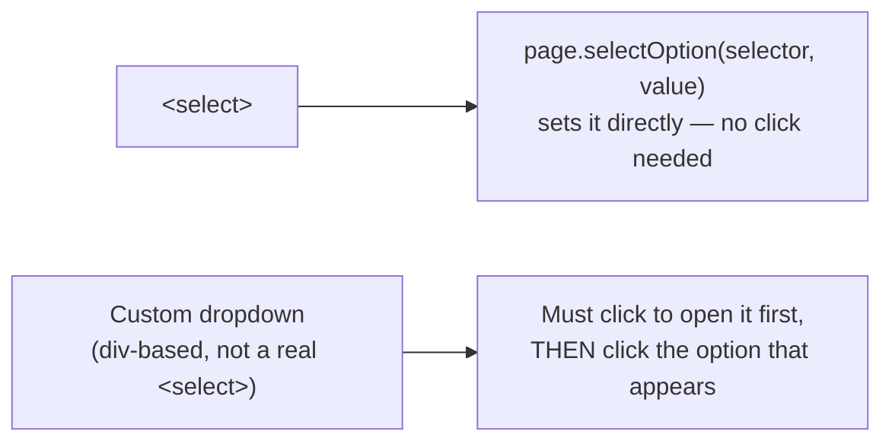
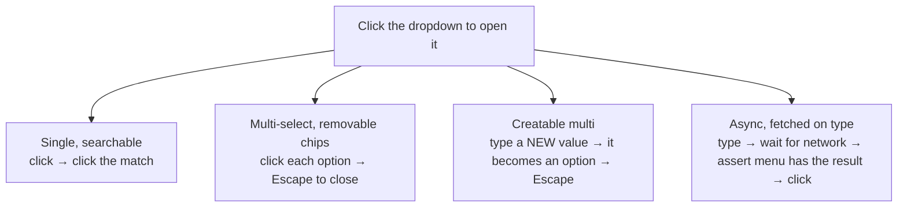

# 08_Web_Select_Frames_Iframe — Notes

Notes for everything covered in `tests/08_Web_Select_Frames_Iframe/`. Despite the folder
name, the files currently in it are all about **dropdowns/`<select>`** — the actual
frame/iframe material lives in `tests/09_Frame_Iframe/` (see `notes/09_Frame_Iframe.md`).
Diagrams are in Mermaid (renders natively on GitHub and in VS Code's preview).

## File map

| File | Concept it teaches |
|---|---|
| `243_Select_TestCase.spec.ts` | Native `<select>` via `selectOption()` |
| `244_CustomDropDown_TestCase.spec.ts` | A simple custom dropdown (ARIA listbox pattern) |
| `245_AdvacneCustomDropDown_TestCase.spec.ts` | Advanced custom dropdowns: searchable, multi-select with chips, creatable, async-loaded |

---

## 1. Native `<select>` — one call, no "opening" needed

```ts
await page.locator("#dropdown").click();
await page.selectOption("#dropdown", "Option 2");
```

`selectOption()` works directly against a native `<select>` element's underlying value —
it doesn't need the dropdown visually "open" first the way a human clicking through the UI
would. The `.click()` here is harmless but unnecessary for a real `<select>`; it only
becomes *necessary* once you're dealing with a custom (non-native) dropdown widget, which
is exactly what sections 2–3 are about.



---

## 2. Custom dropdowns — the ARIA listbox pattern

`244_CustomDropDown_TestCase.spec.ts` targets a dropdown that *isn't* a real `<select>` —
clicking a trigger reveals a list of options rendered as regular elements:

```ts
await page.getByTestId('lang-trigger').click();
await page.getByRole("option", { name: "JavaScript" }).click();

await page.getByTestId('experience-trigger').click();
await page.getByText("Mid-level (4-6 years)", { exact: true }).click();
```

`getByRole("option", ...)` works here because a well-built custom dropdown exposes
`role="option"` on each choice (part of the ARIA "listbox" pattern) — this is exactly why
`getByRole` is first in the locator priority order (`notes/03_Locator_Commands.md` Part
B1): even a hand-rolled `<div>`-based widget is locatable the same way a native element
would be, *as long as the app author added the right ARIA roles*. The second dropdown here
falls back to `getByText` with `exact: true` — a sign that specific option doesn't expose a
role Playwright can match on, so text is the next best thing.

---

## 3. Advanced custom dropdowns — four variants in one file

`245_AdvacneCustomDropDown_TestCase.spec.ts` works through a `react-select`-style widget
library, which commonly ships four distinct interaction patterns:



```ts
// ① Single — searchable: type isn't shown here, but the menu already supports it
await page.locator('#rs-single').click();
await page.getByText("Cypress").click();

// ② Multi — pick more than one, close with Escape instead of clicking elsewhere
await page.locator("#rs-multi").click();
await page.getByText("Pytest", { exact: true }).click();
await page.getByText("JUnit", { exact: true }).click();
await page.keyboard.press("Escape");

// ③ Creatable multi — the typed value itself becomes a new option
await page.locator("#rs-creatable").click();
await page.getByText("api-testing", { exact: true }).click();
await page.getByText("security", { exact: true }).click();
await page.keyboard.press("Escape");

// ⑤ Async — options arrive over the network as you type
await page.locator('#rs-async').click();
await page.getByTestId('rs-async-input').fill('de');
await expect(page.getByTestId('rs-async-menu')).toContainText('Delhi');
await page.getByRole('option', { name: "Delhi", exact: true }).click();
```

**Why the async case needs `expect(...).toContainText(...)` and the others don't:** typing
`'de'` triggers a debounced network request that fetches matching cities — "Delhi" isn't in
the DOM yet the instant `.fill()` resolves. `expect(locator).toContainText(...)` **auto-retries**
until the option actually renders (or times out), which is exactly the auto-waiting behavior
covered in `notes/01_Basics.md` section 7 — this is a genuine case where skipping the
assertion and clicking immediately would be flaky, not just a style preference.

**`page.keyboard.press("Escape")`:** closes an open dropdown without needing to locate a
"close" button — useful for any custom widget that closes on Escape (most do, following
standard combobox keyboard conventions).

---

## Quick recap

| Need | Reach for |
|---|---|
| Native `<select>` | `page.selectOption(selector, value)` — no click needed first |
| Custom dropdown, options exposed via ARIA | Click the trigger, then `getByRole('option', { name })` |
| Custom dropdown, no role on the option | Click the trigger, then `getByText(text, { exact: true })` |
| Close a dropdown without a close button | `page.keyboard.press("Escape")` |
| Options loaded asynchronously after typing | `await expect(menu).toContainText(x)` before clicking — don't click immediately after `.fill()` |
