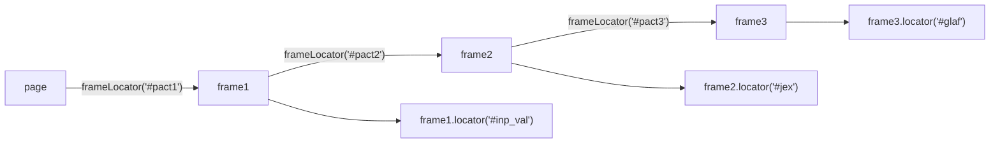

# 09_Frame_Iframe — Notes

Notes for everything covered in `tests/09_Frame_Iframe/`. Diagrams are in Mermaid (renders
natively on GitHub and in VS Code's Markdown preview).

## File map

| File | Concept it teaches |
|---|---|
| `246_Iframe_TestCase.spec.ts` | One iframe, selected by its `id`; filling a form inside it |
| `247_Framework_TestCase.spec.ts` | Multiple named sibling frames; discovering *all* frames on a page |
| `248_Nested_Iframe_TestCase.spec.ts` | Frames nested inside frames, three levels deep |

---

## 1. Locating inside one iframe

A `Locator` built from `page` cannot see inside an `<iframe>` at all — you have to enter
the frame first, via `page.frameLocator(selector)`, and then build locators *from that*:

```ts
let vechileFrame: FrameLocator = page.frameLocator("#frame-one");

await vechileFrame.locator('#RESULT_TextField-1').fill('Hyundai i10');
await vechileFrame.locator('#RESULT_TextField-2').fill('Pramod Dutta');
await vechileFrame.getByText('Submit registration', { exact: true }).click();

let output = await vechileFrame.locator("#vehicle-output").innerText();
```

`frameLocator()` returns a `FrameLocator`, not a `Locator` — but every method you'd expect
(`.locator()`, `.getByText()`, `.getByRole()`, ...) still works on it, automatically scoped
to that iframe's document. This is the whole trick: once you have the `FrameLocator`, the
rest of your code looks identical to working with `page` directly.

**Worth double-checking against the live site:** this file calls
`.selectOption('Hatchback')` on an element whose id is `#RESULT_RadioButton-1`.
`selectOption()` is for native `<select>` elements, not radio inputs — if that field is
genuinely a radio-button group, the correct call would be `.check()` on the specific radio
option instead. Possibly the element is actually a `<select>` despite the "RadioButton"
name in its id (a naming mismatch on the practice site, not in this test), but it's worth
confirming rather than assuming either way.

---

## 2. Multiple named sibling frames, and discovering frames you don't know about

`247_Framework_TestCase.spec.ts` deals with a page that has more than one iframe side by
side, selected by their `name` attribute:

```ts
let mainFrame: FrameLocator = page.frameLocator('[name="main"]');
const headerText = await mainFrame.locator('h2').innerText();

let sideFrame: FrameLocator = page.frameLocator('[name="side"]');
await sideFrame.getByTestId('side-link-registration').click();
```

When you *don't* already know a page's frame structure, this file also shows how to list
every `<frame>` element and inspect it before deciding which one to target:

```ts
const allFrames: Locator[] = await page.locator('//frame').all();
for (const frame of allFrames) {
  console.log(await frame.getAttribute('name'), ': ', await frame.getAttribute('src'));
}
```

Note this loop uses `page.locator('//frame')` — a regular locator matching the `<frame>`
*elements themselves* (to read their `name`/`src` attributes), which is a different thing
from `page.frameLocator(...)`, which gives you a handle to look *inside* one. Reading
"what frames exist and what are they called" is a one-time discovery step; `frameLocator`
is what you then use to actually interact with the content inside the one you picked.

```mermaid
flowchart TD
    P["page"] -- "page.locator('//frame').all()" --> Discover["Inspect every &lt;frame&gt;'s\nname + src attributes"]
    P -- "page.frameLocator('[name=\"main\"]')" --> Main["FrameLocator: main"]
    P -- "page.frameLocator('[name=\"side\"]')" --> Side["FrameLocator: side"]
    Main --> MainContent["locate/interact inside main's document"]
    Side --> SideContent["locate/interact inside side's document"]
```

---

## 3. Nested iframes — frames inside frames

`248_Nested_Iframe_TestCase.spec.ts` is the standout file in this folder: a frame, inside a
frame, inside a frame, three levels deep.

```ts
let frame1: FrameLocator = page.frameLocator('#pact1').first();
let frame2: FrameLocator = frame1.frameLocator('#pact2');
let frame3: FrameLocator = frame2.frameLocator('#pact3');

await frame1.locator('#inp_val').first().fill('Aishwarya Rai');
await frame2.locator('#jex').fill('Wife');
await frame3.locator('#glaf').fill('Playwright');
```

**The key insight:** `FrameLocator` objects are themselves chainable — calling
`.frameLocator()` *on* a `FrameLocator` drills one level deeper, exactly the same way
`.locator()` chains on a `Locator`. There's no separate API for "nested" frames; it's the
same `frameLocator()` call, just called again on the result of the previous one.



**Compare this to tools without `FrameLocator`** (e.g. Selenium's
`driver.switchTo().frame(...)`): there, you must manually *switch into* a frame — a
stateful operation on the whole driver — and manually *switch back out*
(`switchTo().defaultContent()`) before you can touch anything outside it, and nesting means
switching in multiple times in a row and keeping track of how many `switchTo().parentFrame()`
calls you owe. Playwright's `FrameLocator` needs none of that: `frame1`, `frame2`, and
`frame3` above are independent handles you can keep using in any order, nothing ever needs
"switching back."

**Stray line worth cleaning up:** `page.keyboard;` appears on its own line before
`page.pause()` — a property reference with no method call and no effect (likely a leftover
from exploring the `keyboard` API, e.g. meaning to write `page.keyboard.press(...)`). It's
harmless (does nothing, doesn't error) but worth deleting.

---

## Quick recap

| Need | Reach for |
|---|---|
| Interact with content inside one iframe | `page.frameLocator(selector)`, then `.locator()`/`.getByRole()` etc. on it |
| Don't know what frames exist on a page | `page.locator('//frame').all()`, read `name`/`src` per element |
| Multiple frames side by side | A separate `frameLocator(...)` per frame, selected by `[name="..."]` or id |
| A frame nested inside another frame | Call `.frameLocator()` again on the outer `FrameLocator` — it chains |
| Switching back out after a frame (Selenium habit) | Not needed — `FrameLocator` handles don't require "switching back" |
