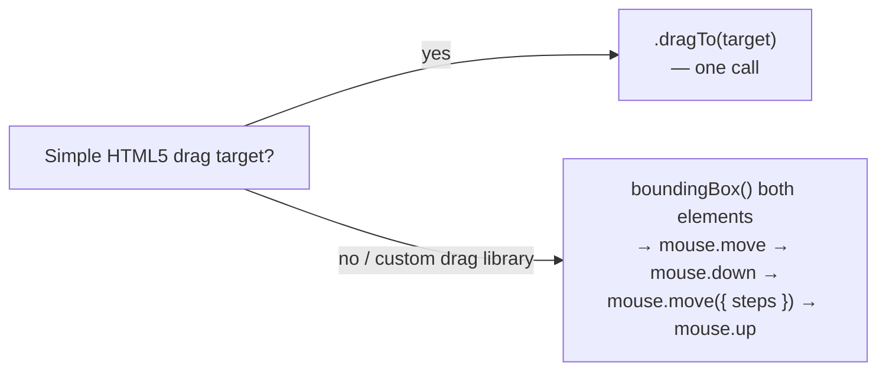

# 10_Keyboard_Hover_Drag_Drop_Calender — Notes

Notes for everything covered in `tests/10_Keyboard_Hover_Drag_Drop_Calender/`. No calendar
file exists yet despite the folder name — these notes cover keyboard, hover, and the two
levels of drag-and-drop that are actually there. Diagrams are in Mermaid (renders natively
on GitHub and in VS Code's preview).

## File map

| File | Concept it teaches |
|---|---|
| `249_TestCase.spec.ts` | `page.keyboard.press/up/down` — simulating individual key presses |
| `250_Hover_TestCase.spec.ts` | `.hover()` — revealing a menu that only appears on mouseover |
| `251_Drag_Drop.spec.ts` | `.dragTo()` — the simple, built-in drag-and-drop API |
| `252_Advance_Drag_Drop.spec.ts` | Manual `page.mouse` sequence — for widgets `.dragTo()` can't handle |
| `253_Context_Drag_Drop.spec.ts` | Right-click (`{ button: 'right' }`) to open a context menu |

---

## 1. Keyboard: press, up, down

```ts
await page.keyboard.press('A');            // press and release one key
await page.keyboard.press('ArrowLeft');    // non-character keys use their name
await page.keyboard.press('Shift+O');      // modifier + key combo, "+"-joined

await page.keyboard.up("Shift");           // release a held key
await page.keyboard.down("Shift");         // press and HOLD a key (doesn't release it)
```

`.press()` is a full press-then-release in one call — use it for anything that doesn't need
a key held while something else happens. `.down()`/`.up()` exist for the cases that do: e.g.
holding Shift while clicking multiple items, or holding a letter key to test key-repeat
behavior. `249_TestCase.spec.ts` calls `.down("Shift")` *after* `.up("Shift")` with nothing
in between, so that pair doesn't do anything observable here — it's just demonstrating the
two calls exist, not a real held-key scenario.

**Side effect worth knowing about:** this file calls `page.screenshot({ path: 'A.png' })`
(and similarly for `O.png`, `ArrowLeft.png`) with a relative path — these land as loose
files in the repo root, not under `test-results/`. They're already covered by `.gitignore`
(`/A.png`, `/O.png`, `/ArrowLeft.png`), which also tells you this has happened before.

---

## 2. Hover — revealing something that only shows up on mouseover

```ts
await page.getByText('Add-ons', { exact: true }).hover();
await page.getByText('FlyEarly', { exact: true }).click();
```

Some menus/tooltips only render their contents once the mouse moves over a trigger
element — clicking "FlyEarly" directly would fail if it doesn't exist in the DOM (or isn't
visible) until "Add-ons" has been hovered first. `.hover()` moves the mouse there and waits
for the element to be ready for it, the same auto-waiting behavior every other Playwright
action gets.

---

## 3. Drag-and-drop: the easy way vs. the manual way

`251_Drag_Drop.spec.ts` uses Playwright's built-in one-liner:

```ts
const columnA = page.locator('#column-a');
const columnB = page.locator('#column-b');
await columnA.dragTo(columnB);
```

`.dragTo()` handles the whole sequence (hover source → mouse down → move → mouse up over
target) for you. It works for standard HTML5 drag-and-drop and most simple cases.

`252_Advance_Drag_Drop.spec.ts` drops down to the raw `page.mouse` API instead, for a
Kanban-style board where `.dragTo()` isn't reliable (common with drag libraries that need
gradual mouse movement to trigger their internal drag state, rather than one instant jump):

```ts
const sBox = (await source.boundingBox())!;
const tBox = (await target.boundingBox())!;

await page.mouse.move(sBox.x + sBox.width / 2, sBox.y + sBox.height / 2); // move to source center
await page.mouse.down();                                                   // press down
await page.mouse.move(tBox.x + tBox.width / 2, tBox.y + tBox.height / 2, { steps: 15 }); // move gradually
await page.mouse.up();                                                     // release over target
```



**Why `{ steps: 15 }` matters:** a single `mouse.move()` jumps instantly from A to B. Many
JS drag-and-drop libraries listen for a *series* of `mousemove` events to compute drag
state (what's being dragged over, drop-zone highlighting, etc.) — `steps` tells Playwright
to fire that many intermediate `mousemove` events along the path, simulating a real drag
instead of a teleport the library's listeners might miss entirely.

**`boundingBox()` returns `null` if the element isn't visible/attached** — the `!` (non-null
assertion) in this file assumes it always will be. Fine for a quick exploratory script;
worth an actual null-check (or `expect(box).not.toBeNull()`) in a real test, since a renamed
selector would otherwise fail with a confusing "Cannot read properties of null" instead of a
clear "element not found" message.

---

## 4. Right-click → context menu

```ts
await page.locator('span.context-menu-one').first().click({ button: 'right' });

const allOptions: string[] = await page.locator('ul.context-menu-list span').allInnerTexts();
console.log(allOptions);

await page.getByText('Copy', { exact: true }).first().click();
```

`{ button: 'right' }` on `.click()` is the whole trick — same `.click()` call used
everywhere else, just telling it which mouse button to use (also accepts `'middle'`).
Once the context menu is open, it's just a normal list of elements — `.allInnerTexts()`
(topic 06) to see what's on offer, then a normal `.click()` on the one you want.

---

## Quick recap

| Need | Reach for |
|---|---|
| One key press (with optional modifiers) | `page.keyboard.press('Shift+O')` |
| Hold a key across multiple actions | `page.keyboard.down(key)` ... `page.keyboard.up(key)` |
| Reveal a hover-only menu | `.hover()` before interacting with what it reveals |
| Standard drag-and-drop | `.dragTo(target)` |
| Drag-and-drop that needs gradual movement (custom JS drag libs) | `boundingBox()` + `mouse.move/down/move({ steps })/up` |
| Right-click / middle-click | `.click({ button: 'right' | 'middle' })` |
