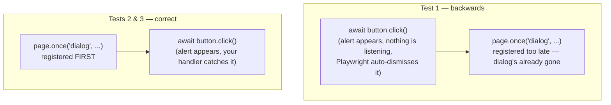

# 11_JS_Alerts — Notes

Notes for everything covered in `tests/11_JS_Alerts/`. One file, three dialog types — and
a real ordering bug in the first test that's worth understanding precisely, since it's the
single most common mistake with Playwright dialog handling. Diagrams are in Mermaid
(renders natively on GitHub and in VS Code's preview).

## File map

| File | Concept it teaches |
|---|---|
| `254_JS_Alerts.spec.ts` | Handling `alert()`, `confirm()`, and `prompt()` via the `dialog` event |

---

## 1. Why dialogs need an event listener, not a normal locator

A native browser `alert()`/`confirm()`/`prompt()` isn't part of the page's DOM — there's no
element to `page.locator()`. Instead, Playwright fires a `dialog` event the moment one
appears, and you handle it by listening for that event:

```ts
page.once('dialog', async dialog => {
  console.log(dialog.type());      // 'alert' | 'confirm' | 'prompt' | 'beforeunload'
  console.log(dialog.message());   // the text shown to the user
  await dialog.accept();           // click OK  (or dialog.accept('text') for a prompt's answer)
  // await dialog.dismiss();       // click Cancel, instead
});
```

`.once(...)` (rather than `.on(...)`) auto-removes the listener after it fires — the right
choice here since each test triggers exactly one dialog.

---

## 2. ⚠️ Ordering matters — and the first test gets it backwards

Compare the three tests in this file closely:

```ts
// Test 1 — "JS Alert accept 1": click FIRST, listener SECOND
await page.getByRole('button', { name: "Click for JS Alert" }).click();
page.once('dialog', async dialog => { /* ... */ });

// Test 2 — "JS Alert accept 2": listener FIRST, click SECOND
page.once('dialog', async dialog => { /* ... */ });
await page.locator('button', { hasText: 'Click for JS Confirm' }).click();
```

Test 2 and 3 have it right; **test 1 has the order backwards.** A browser alert blocks the
page the instant it appears — Playwright needs a `dialog` handler already registered at
that moment, or its default behavior kicks in (auto-dismissing the dialog) before your
`page.once('dialog', ...)` line ever runs. Registering the listener *after* `.click()` is
awaited is too late: by the time that line executes, the alert may already be gone.



**The fix:** always register the dialog handler *before* the action that triggers it —
exactly the pattern tests 2 and 3 already use. This is also why `page.once` is set up
*without* an `await` in front of it (it just registers a callback, it doesn't wait for a
dialog to happen) — the actual waiting happens naturally when `.click()` triggers the
dialog and the registered callback fires.

---

## 3. The three dialog types, side by side

```ts
// alert() — only has an OK button, nothing to assert on besides message/type
expect(dialog.type()).toBe('alert');     // (test 1's intent, even if mistimed)

// confirm() — OK or Cancel; .accept() = OK, .dismiss() = Cancel
expect(dialog.type()).toBe('confirm');
expect(dialog.message()).toBe('I am a JS Confirm');
await dialog.accept();
await expect(page.locator('#result')).toHaveText('You clicked: Ok');

// prompt() — has a text input; .accept(text) both clicks OK AND fills the input
expect(dialog.type()).toBe('prompt');
expect(dialog.defaultValue()).toBe('');            // what the input started with
await dialog.accept('Hello from The Testing Academy');
await expect(page.locator('#result')).toHaveText('You entered: Hello from The Testing Academy');
```

| Dialog type | `.accept()` | `.dismiss()` | Anything special |
|---|---|---|---|
| `alert` | Clicks OK | N/A (alerts have no Cancel) | Just a message |
| `confirm` | Clicks OK | Clicks Cancel | Returns true/false to the page's JS |
| `prompt` | `.accept(text)` clicks OK **and** fills the input | Clicks Cancel | `.defaultValue()` reads the input's starting value |

---

## Quick recap

| Need | Reach for |
|---|---|
| Handle any native alert/confirm/prompt | `page.once('dialog', async dialog => { ... })` |
| **Register it before or after the triggering click?** | **Before, always** — late registration risks the dialog auto-dismissing first |
| Click OK | `await dialog.accept()` |
| Click Cancel | `await dialog.dismiss()` |
| Answer a prompt | `await dialog.accept('your text')` |
| Inspect without handling yet | `dialog.type()`, `dialog.message()`, `dialog.defaultValue()` |
