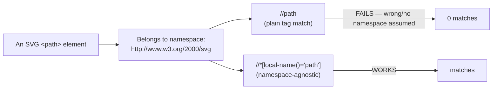

# 12_Handle_SVG — Notes

Notes for everything covered in `tests/12_Handle_SVG/`. The throughline across these four
files is one lesson: SVG elements live in a different XML namespace than HTML, which trips
up XPath — and the last two files show the student discovering that plain CSS locators
don't have that problem at all. Diagrams are in Mermaid (renders natively on GitHub and in
VS Code's preview).

## File map

| File | Concept it teaches |
|---|---|
| `255_SVG_Handling_Testcase.spec.ts` | Clicking an inline `<svg>` icon (a search button), XPath on the results |
| `256_SVG_Advance_TC.spec.ts` | Clicking individual SVG shapes (`<circle>`), reading SVG bar-chart attributes |
| `257_SVG_Maps_TC.spec.ts` | SVG namespace problem: `local-name()` needed to match `<svg>`/`<path>` via XPath |
| `258_257_SVG_Maps_Optimized_TC.spec.ts` | Same map, but with a plain CSS `path` selector — no namespace workaround needed |

---

## 1. SVG elements are still just elements — `page.locator()` finds them fine

`255_SVG_Handling_Testcase.spec.ts` and `256_SVG_Advance_TC.spec.ts` click directly into
SVG shapes the same way you'd click any HTML element:

```ts
const svgElement: Locator = page.locator('svg');
await svgElement.first().click();

const circleShape: Locator = page.locator('#circle-blue');
await circleShape.click();
```

Reading an SVG bar chart's data attributes works the same as any other element too:

```ts
let allBars = await page.locator(".bar").all();
for (const bar of allBars) {
  const q = await bar.getAttribute('data-quarter');
  const h = await bar.getAttribute('height');
}
```

So far, nothing SVG-specific — CSS locators (`id`, `.class`, `[attr]`) work on `<svg>`,
`<circle>`, `<rect>`, `<path>`, etc. exactly like they work on `<div>`. The complication
only shows up with XPath, in section 2.

---

## 2. The XPath namespace trap

`257_SVG_Maps_TC.spec.ts` needs `local-name()` to match `<svg>` and `<path>` elements:

```ts
const states = await page.locator(
  "//*[local-name()='svg']//*[local-name()='path' and contains(@class,'sm_state')]"
).all();
```

**Why not just `//svg//path`?** SVG content lives in the `http://www.w3.org/2000/svg` XML
namespace, which is different from the (unnamespaced) HTML elements around it. A strict
XPath engine matching `path` as a plain tag name is actually asking for an element named
`path` with *no* namespace — which doesn't match an SVG `<path>` at all, since it carries
the SVG namespace. `local-name()` sidesteps this by matching on the tag's local name only
("path"), ignoring which namespace it belongs to — the standard escape hatch for XPath
against SVG/XML content.



---

## 3. The discovery: CSS doesn't have this problem at all

`258_257_SVG_Maps_Optimized_TC.spec.ts` is the exact same map, rewritten:

```ts
let allStates = await page.locator('path').all();
for (const state of allStates) {
  const className = await state.getAttribute('class');
  if (className?.endsWith("TN")) {
    await state.click();
  }
}
```

No `local-name()`, no namespace juggling — `page.locator('path')` just works, because
Playwright's CSS engine operates on the live, rendered DOM tree in the browser (where
`<path>` is simply a tag like any other for selector-matching purposes), not on strict
XML-namespace-aware parsing the way a generic XPath processor would. This is the practical
payoff of the CSS-vs-XPath comparison in `notes/03_Locator_Commands.md` Part B4: XPath
*can* do things CSS can't (parent/ancestor traversal), but here it's CSS that turns out to
be the simpler, less error-prone tool — pick XPath because you need its specific power, not
by default.

**One real bug in `257` worth fixing:** `state.click()` inside the loop is missing
`await`:

```ts
if (classState?.includes("INUP")) {
  state.click();   // ⚠️ not awaited
}
```

Without `await`, the loop doesn't wait for the click to actually happen before moving to
the next iteration — the click fires, but the test has already moved on (and if it's the
last line before the test ends, Playwright may tear down the page before the click even
completes). `258`'s equivalent line correctly has `await state.click();`.

---

## Quick recap

| Need | Reach for |
|---|---|
| Click/read any SVG element by id, class, or attribute | A normal CSS locator — SVG is not special for CSS |
| Match an SVG tag by XPath | `//*[local-name()='svg']` / `local-name()='path'` — NOT a plain tag match |
| Avoid the namespace problem entirely | Prefer CSS (`page.locator('path')`) over XPath for SVG unless you need XPath's own powers |
| Clicking inside a loop | Don't forget `await` — a missed `await` on `.click()` silently breaks the wait-before-continuing guarantee |
