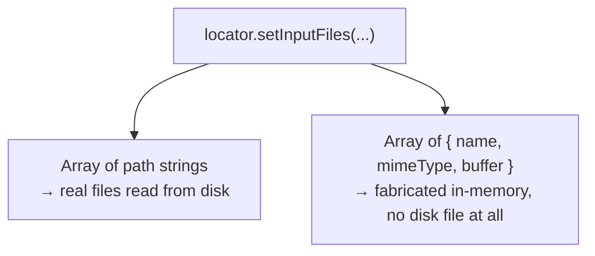
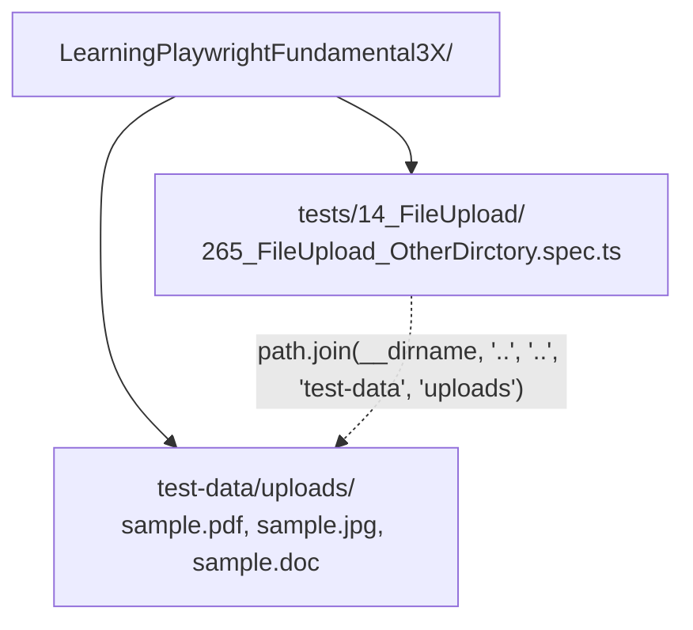

# 14_FileUpload — Notes

Notes for everything covered in `tests/14_FileUpload/`. Six files, each adding one more
layer: a single real file → a path helper → in-memory files with no disk file at all →
real files again → mixed file types → files living outside the test folder entirely.
Diagrams are in Mermaid (renders natively on GitHub and in VS Code's preview).

## File map

| File | Concept it teaches |
|---|---|
| `260_FileUpload_TC.spec.ts` | `setInputFiles()` with one real file, located via `path.join(__dirname, ...)` |
| `261_FileUpload_Own_TC.spec.ts` | Same pattern, against this course's own practice widget |
| `262_MultipleFileUpload_TC.spec.ts` | In-memory files — `{ name, mimeType, buffer }`, no disk file needed |
| `263_Multiple_FileUpload_Disk_TC.spec.ts` | Multiple *real* files from disk, asserting the dropzone lists both names |
| `264_MultipleMixed_FileUpload_MixedTypes_Disk_TC.spec.ts` | Mixed file types (PDF, JPG, DOC) in one upload |
| `265_FileUpload_OtherDirctory.spec.ts` | Files living in a shared folder *outside* the test's own directory |

---

## 1. `setInputFiles()` — the whole API, in two shapes

```ts
// Shape 1: path(s) to real file(s) on disk
await page.locator("#file-upload").setInputFiles([filePath]);

// Shape 2: in-memory file(s) — no disk file needed at all
await page.locator("input").setInputFiles([
  { name: 'file1.jpg', mimeType: 'image/jpeg', buffer: Buffer.from('image from thetestingacademy code') },
]);
```

`setInputFiles()` sets a native `<input type="file">`'s selected files directly — it does
**not** open the OS's file picker dialog the way a real user would (there's no dialog to
automate at all; you're setting the input's value programmatically, which is exactly what
the browser does after a user finishes picking files anyway).



**Why bother with in-memory files (`262`)?** No fixture file to keep in the repo, no risk
of it going stale/missing, and you can generate content on the fly (e.g. a buffer that's
exactly the size needed to test an upload-size limit). The tradeoff: you can't use it to
test "does this *specific* real file upload and render correctly" — for that, disk files
(`260`, `263`, `264`, `265`) are what you actually want.

---

## 2. `path.join(__dirname, ...)` — why every disk-based file uses it

```ts
const filePath = path.join(__dirname, 'testdata.txt');
```

`__dirname` is the folder the *current file* lives in, regardless of where you ran
`npx playwright test` from. `path.join()` combines it with the filename in an
OS-correct way (`/` on macOS/Linux, `\` on Windows). Without this, a hardcoded relative
path like `'testdata.txt'` would only resolve correctly if the test runner's current
working directory happened to be `tests/14_FileUpload/` — which it normally isn't.

---

## 3. Uploading multiple files, then asserting the dropzone reflects them

`263` and `264` upload several files in one `setInputFiles()` call and verify each name
shows up in the widget:

```ts
await page.locator('div.pf-v6-c-multiple-file-upload input').setInputFiles([file1, file2]);

const uploadArea = page.locator('div.pf-v6-c-multiple-file-upload');
await expect(uploadArea).toContainText('file1.jpg');
await expect(uploadArea).toContainText('file2.jpg');
```

One array, multiple files, one locator — no loop needed for the upload itself. `264` does
the same with genuinely different file types (`.pdf`, `.jpg`, `.doc`) in a single call,
confirming the widget doesn't care about mixing types.

---

## 4. Fixtures that live outside the test's own folder

`265_FileUpload_OtherDirctory.spec.ts` reaches *up and across* to a shared folder:

```ts
const UPLOAD_DIR = path.join(__dirname, '..', '..', 'test-data', 'uploads');
const files = ['sample.pdf', 'sample.jpg', 'sample.doc'].map(name => path.join(UPLOAD_DIR, name));
```



**Why put fixtures in a shared `test-data/` instead of next to each spec:** the files
already living in `tests/14_FileUpload/` (`file1.jpg`, `testdata.txt`, `upload-sample.pdf`,
etc.) only make sense for *this* topic. A shared `test-data/uploads/` folder is the natural
place once a second topic (or a future one) needs the same sample files, instead of
duplicating them per-folder. `..`/`..` walking up from `__dirname` is what makes the path
correct regardless of where the test runner is invoked from — same reasoning as `__dirname`
itself in section 2.

---

## 5. ⚠️ Unnecessary dependency: `"path"` in `package.json`

Every file here does `import path from 'path'`. That's Node's **built-in** `path` module —
it ships with Node itself and has never needed installing. At some point `npm install path`
was run, which added a real (and very old — v0.12.7, last published over a decade ago)
third-party package literally named `path` to `dependencies`.

**Is this actually broken right now?** No — verified directly: Node's module resolution
always checks built-in core modules *before* `node_modules` for a bare specifier like
`'path'`, so `require('path')`/`import path from 'path'` still resolves to Node's own
built-in either way, and `path.join(...)` behaves correctly. The installed package just
sits in `node_modules/path` unused.

**Still worth removing:** it's dead weight in `package.json`, and it signals (to anyone
else reading the dependency list) that `path` needed installing, which isn't true and could
mislead a future contributor into thinking the same mistake is necessary elsewhere (e.g.
`npm install fs`, `npm install os` — all equally unnecessary Node built-ins).

```bash
npm uninstall path
```

---

## Quick recap

| Need | Reach for |
|---|---|
| Upload one or more real files | `locator.setInputFiles([path1, path2, ...])` |
| Upload fabricated content, no disk file | `locator.setInputFiles([{ name, mimeType, buffer }])` |
| Build a path relative to the current file | `path.join(__dirname, 'file.ext')` |
| Fixtures shared across multiple topics | A top-level `test-data/` folder, reached via `path.join(__dirname, '..', '..', ...)` |
| Assert an upload widget accepted the files | `expect(uploadArea).toContainText(filename)` |
| `npm install path`/`fs`/`os`/etc. | Don't — these are Node built-ins, never need installing (and here, `npm uninstall path` is a safe cleanup) |
