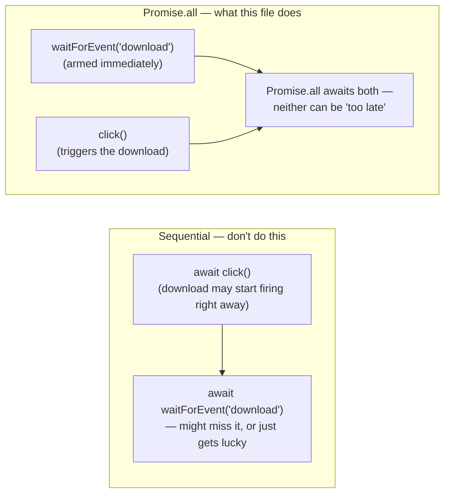

# 15_File_Download — Notes

Notes for everything covered in `tests/15_File_Download/`. One file, and it's the download
mirror image of the dialog-ordering lesson from `notes/11_JS_Alerts.md` — same underlying
shape, different event. Diagrams are in Mermaid (renders natively on GitHub and in VS
Code's preview).

## File map

| File | Concept it teaches |
|---|---|
| `266_FileDownload.spec.ts` | `page.waitForEvent('download')` + `Promise.all` — capturing a triggered download |

---

## 1. Why the listener and the click are wrapped in `Promise.all`

```ts
const [staticDownload] = await Promise.all([
  page.waitForEvent('download'),
  page.getByTestId('download-static').click(),
]);

await staticDownload.saveAs('./out/' + staticDownload.suggestedFilename());
```

This is the same category of problem as dialogs (`notes/11_JS_Alerts.md` section 2): the
`download` event fires as a *consequence* of the click, so the listener has to be armed
**before** (or at the exact same time as) the click happens, not after it. The difference
from the dialog case is the fix looks different in code:

- **Dialogs:** register `page.once('dialog', ...)` first, *then* `await` the click
  separately — because a dialog's handler needs to run synchronously as part of handling
  the browser-level pause, not return a value you need back in your test.
- **Downloads:** `page.waitForEvent('download')` returns a `Promise<Download>` immediately
  (it doesn't block yet) — so you kick it off *and* the click *at the same time* inside
  `Promise.all([...])`, and both promises are awaited together. Writing this sequentially
  instead (`await click(); await page.waitForEvent('download')`) risks the same race as the
  dialog case: the download could start and finish before `waitForEvent` starts listening.



---

## 2. What you get back: a `Download` object, not a file yet

The click + `waitForEvent` pair resolves to a `Download` object — at this point Playwright
has already captured the download into a temporary location, but it hasn't been saved
anywhere *you* control yet:

```ts
await staticDownload.saveAs('./out/' + staticDownload.suggestedFilename());
```

- `suggestedFilename()` — the filename the server/browser would normally suggest (from the
  `Content-Disposition` header or the URL), so you don't have to hardcode it.
- `.saveAs(path)` — copies the downloaded file to a path of your choosing. `./out/` here is
  already covered by `.gitignore` (`/out/`), so these downloaded files never get committed.

Other `Download` methods worth knowing even though this file doesn't use them: `.path()`
(the temp file's actual location, if you need to read it in place instead of copying it),
`.failure()` (returns an error message if the download failed instead of succeeding), and
`.delete()` (clean up the temp file early instead of waiting for the browser context to
close).

---

## Quick recap

| Need | Reach for |
|---|---|
| Capture a download triggered by an action | `Promise.all([page.waitForEvent('download'), action()])` — never sequentially |
| The filename the site suggests | `download.suggestedFilename()` |
| Save it somewhere specific | `await download.saveAs(path)` |
| Read it without copying it | `download.path()` |
| Check whether it actually failed | `download.failure()` |
