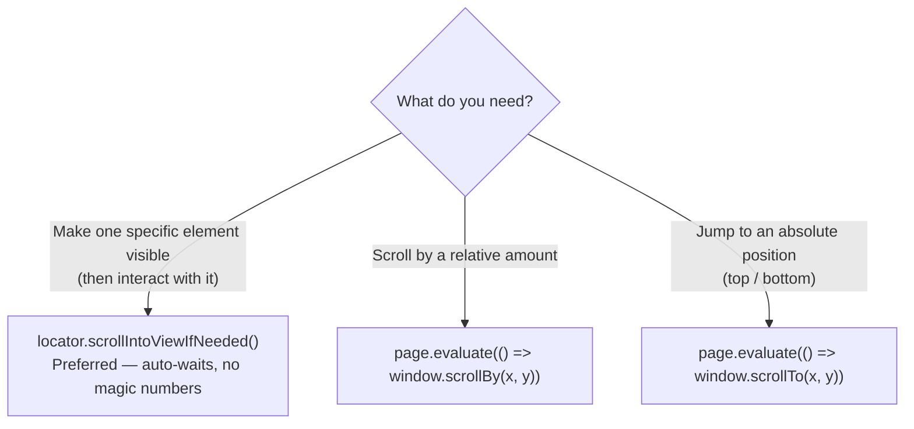
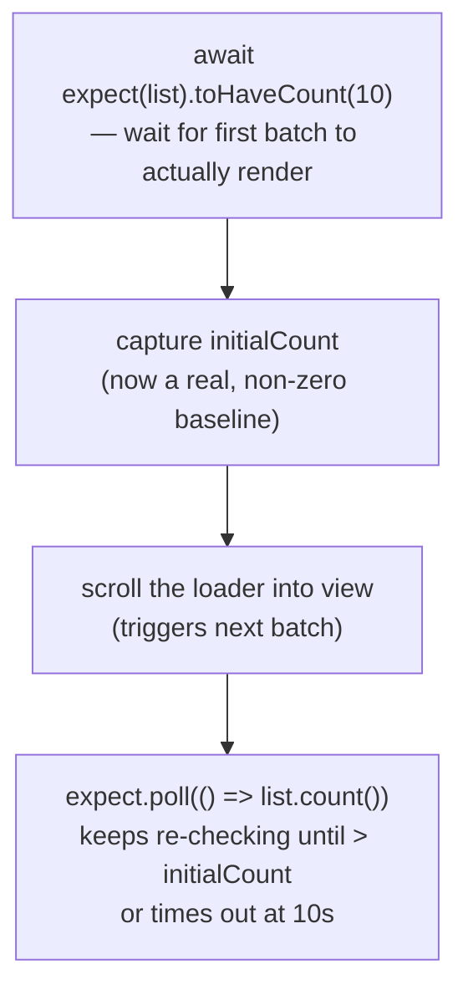
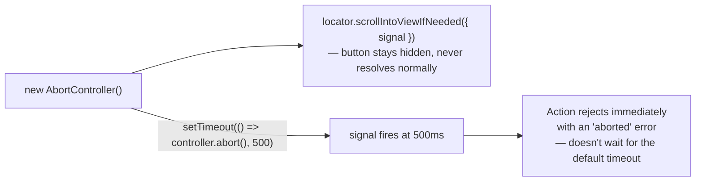

# 16_Scroll_toElement — Notes

Notes for everything covered in `tests/16_Scroll_toElement/`. Diagrams are in Mermaid
(renders natively on GitHub and in VS Code's Markdown preview).

## File map

| File | Concept it teaches |
|---|---|
| `267_Scroll_Tc.spec.ts` | `scrollIntoViewIfNeeded()` vs manual `window.scrollBy`/`scrollTo` via `page.evaluate` |
| `268_Lazy_Scroll.spec.ts` | Polling a growing list with `expect.poll` while a lazy-loader triggers more items |
| `269_Abort_Signal_Scroll.spec.ts` | Cancelling a scroll wait early with an `AbortSignal` (v1.62+) |

---

## 1. Four ways to scroll, and when each one is right

`267_Scroll_Tc.spec.ts` runs through the options in order of preference:

```ts
// 1) Scroll an element into view — Playwright figures out how far, waits for it to settle
await page.getByTestId("deep-anchor").scrollIntoViewIfNeeded();
await page.getByTestId('deep-anchor').click();

// 2) Scroll the window by a relative offset
await page.evaluate(() => window.scrollBy(0, 1000));

// 3) Jump straight to the bottom
await page.evaluate(() => window.scrollTo(0, document.body.scrollHeight));

// 4) Jump back to the top
await page.evaluate(() => window.scrollTo(0, 0));
```



**Why `scrollIntoViewIfNeeded()` is the default choice:** it's a locator action, so it
auto-waits for the element to exist and settle, and it only scrolls if the element isn't
already visible — no need to calculate pixel offsets or guess the page height. Reach for
`window.scrollBy`/`scrollTo` only when you genuinely need window-level scroll (e.g. testing
a "back to top" button, or a sticky header's scroll-triggered style).

---

## 2. Polling a lazy-loading list

`268_Lazy_Scroll.spec.ts` tests a list that grows as you scroll — a classic "infinite
scroll" / lazy-load widget:

```ts
const list = page.getByTestId('lazy-list').locator('li');

// wait for the first load to land before reading the count
await expect(list).toHaveCount(10);
const initialCount = await list.count();

// scroll back up, then bring the loader back into view to trigger the next batch
await page.evaluate(() => window.scrollTo(0, 0));
await page.getByTestId('lazy-loader').scrollIntoViewIfNeeded();

await expect.poll(async () => list.count(), {
  message: "expected_itmes > 10",
  timeout: 10_000,
}).toBeGreaterThan(initialCount);
```

**The race condition this avoids:** the file's own comment spells it out — *"wait for the
first load to land (two batches of 5) before reading the count; read too early, initialCount
is 0 and the poll below passes without any scroll."* If you capture `initialCount` before the
list has rendered anything, `toBeGreaterThan(0)` is trivially true the moment a single item
shows up — the test "passes" without ever proving lazy-loading works.



**`expect.poll` vs a single assertion:** the new items don't appear the instant you scroll —
there's a network/render delay. `expect.poll` re-runs the callback (`list.count()`) on an
interval until the matcher passes or the timeout elapses, which is exactly what you need for
"eventually becomes true" conditions that aren't already covered by a built-in locator
assertion like `toHaveCount`.

---

## 3. Don't scroll to an element that doesn't exist yet

A trap documented directly in `269_Abort_Signal_Scroll.spec.ts`'s commented-out code:

```ts
// scroll the LAST existing item into view — item 11 does not exist yet,
// so nth(10) would just wait until the test times out.
// await list.last().scrollIntoViewIfNeeded({ signal: controller.signal });
```

If you try to `scrollIntoViewIfNeeded()` on `list.nth(10)` (the 11th item) before the lazy
loader has produced it, the locator has nothing to resolve to — it just waits out the full
timeout and fails. The fix used instead is the same `expect.poll` pattern from section 2:
poll the **count**, not a locator for an item that may not exist.

---

## 4. Cancelling a wait early with `AbortSignal` (v1.62+)

```ts
test('cancel the wait with an AbortSignal (v1.62+)', async ({ page }) => {
  await page.setContent('<button style="display:none">Hidden</button>');
  const controller = new AbortController();
  setTimeout(() => controller.abort(), 500);

  await expect(
    page.locator('button').scrollIntoViewIfNeeded({ signal: controller.signal })
  ).rejects.toThrow('aborted');
});
```

Most locator actions (including `scrollIntoViewIfNeeded`) accept a standard `AbortSignal` via
the `signal` option. Aborting it rejects the in-flight action immediately instead of waiting
for the full default timeout — useful when you have your own reason to give up early (e.g. a
parallel check already failed, so there's no point waiting out the rest of this one).



---

## Quick recap

| Need | Reach for |
|---|---|
| Make one element visible, then act on it | `locator.scrollIntoViewIfNeeded()` — auto-waits, preferred |
| Scroll by a relative offset | `page.evaluate(() => window.scrollBy(x, y))` |
| Jump to top/bottom | `page.evaluate(() => window.scrollTo(x, y))` |
| Wait for a count to pass a baseline | capture the baseline **after** the first real render, then `expect.poll(() => locator.count())` |
| Target an item that may not exist yet | poll the count, don't scroll/locate by index |
| Give up on a wait early | pass `{ signal: abortController.signal }` to the action |
