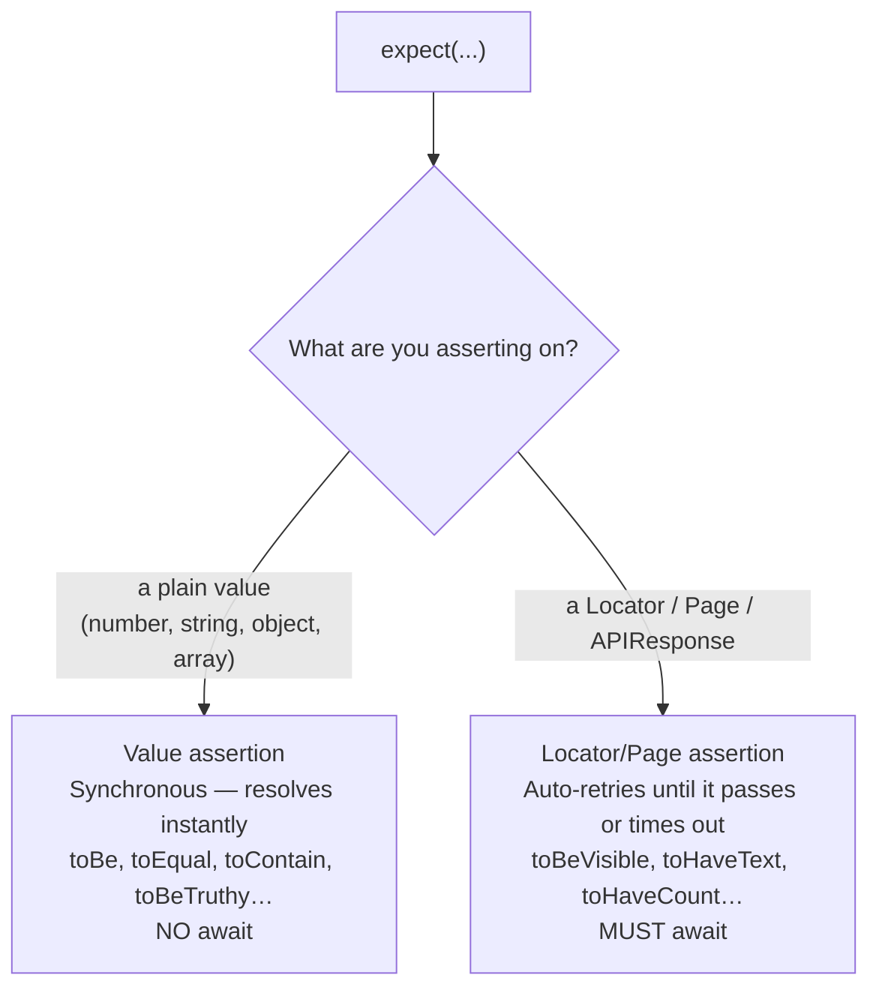
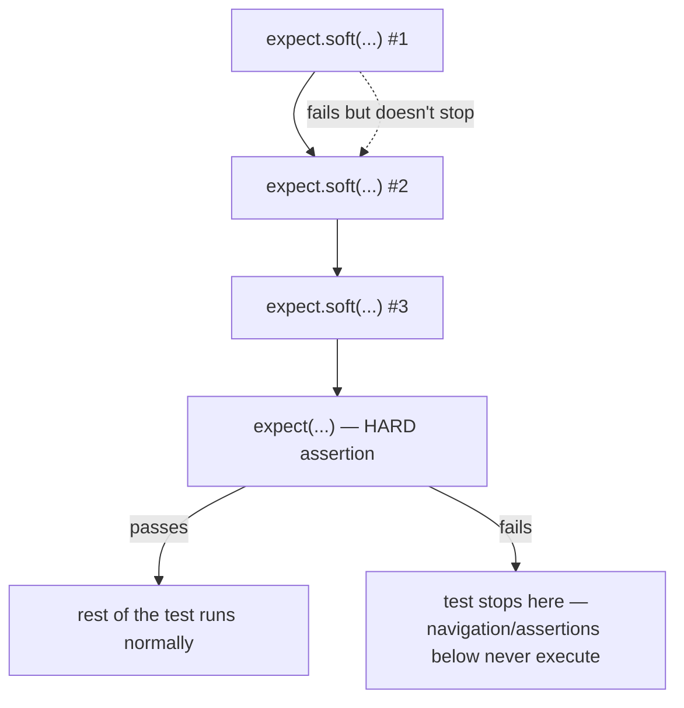

# 17_Expect_Assertions — Notes

Notes for everything covered in `tests/17_Expect_Assertions/`. This folder already has an
exhaustive reference — **[`Expect_CheatSheet.md`](../tests/17_Expect_Assertions/Expect_CheatSheet.md)**
lists every `expect` matcher with one example each. These notes don't repeat that table;
they walk through what the four actual spec files demonstrate and why. Diagrams are in
Mermaid (renders natively on GitHub and in VS Code's Markdown preview).

## File map

| File | Concept it teaches |
|---|---|
| `270_Expect1.spec.ts` | Value assertions — synchronous, no `await`, no retrying |
| `271_Expect2.spec.ts` | Locator assertions — async, auto-retrying, must be `await`-ed |
| `272_Expect3.spec.ts` | `expect.soft` vs hard assertions, and `.not` negation |
| `273_Expect4.spec.ts` | State assertions (`toBeChecked`/`toBeEnabled`) vs plain value checks on `page.url()`/`page.title()` |
| `Expect_CheatSheet.md` | Full matcher reference — every assertion type, one example each |

---

## 1. Two completely different kinds of `expect`

The single most important distinction in this folder, and the one `270_Expect1.spec.ts`
exists to drill in:

```ts
// Value assertions — plain JS values, resolve instantly, NEVER await
expect(1 + 2).toBe(3);
expect(ac).toBeFalsy();
expect([1, 2, 3]).toEqual([1, 2, 3]);
expect({ age: 20, role: 'admin' }).toEqual({ role: 'admin', age: 20 }); // key order doesn't matter
```

```ts
// Locator/Page assertions — auto-retrying, ALWAYS await
await expect(heading).toBeVisible();
await expect(email).toHaveAttribute('id', 'email');
```



**Why this matters:** forgetting `await` on a Locator assertion is a classic silent bug — the
promise just fires and is abandoned, so the test moves on without actually checking anything
and still "passes." Forgetting `await` on a value assertion is harmless (there's no promise to
miss) but also pointless, since `expect(1+2).toBe(3)` never needed to wait for anything.

---

## 2. Locator assertions in practice

`271_Expect2.spec.ts` chains several together on a real form:

```ts
const heading = page.getByText('multiple element filters', { exact: true });
await expect(heading).toBeVisible();
await expect(heading).toContainText('filter', { timeout: 10000 });

const email = page.getByRole('textbox', { name: 'Email Address' });
await expect(email).toHaveAttribute('id', 'email');
await expect(email).toHaveAttribute('type', 'email');
await expect(email).toHaveAttribute('placeholder', 'student@thetestingacademy.com');

const footerLinks = page.locator('footer a');
await expect(footerLinks).toHaveCount(16);
```

Two things worth noticing:
- **Per-assertion timeout override** — `toContainText('filter', { timeout: 10000 })` extends
  just this one check past the default 5s, without touching global config.
- **`toHaveAttribute` as a structural check** — verifying `id`/`type`/`placeholder` pins down
  exactly which input you're testing, which matters once a page has more than one textbox.

---

## 3. Soft vs hard assertions

`272_Expect3.spec.ts` is the one file in this folder to actually read closely — it mixes
both styles in the same test on purpose:

```ts
// Soft: each line records its own failure, test keeps running either way
await expect.soft(firstName).toHaveAttribute('id', 'first-name');
await expect.soft(firstName).toBeVisible();
await expect.soft(firstName).toHaveValue('');

// Hard: this line still runs after the soft block above —
// but if THIS one fails, everything below it is skipped
await expect(firstName).toBeEnabled();

// this line does NOT run if the hard assertion above failed
await page.goto('https://app.thetestingacademy.com/playwright/webtable.html');
await expect(page.locator('#error')).not.toBeVisible();

let title = await page.title();
expect(title).not.toContain('error'); // value assertion, .not works here too
```



**Why mix them:** soft assertions are for "check several independent things and report all
the failures at once" (e.g. three attributes on the same field) — useful so one broken
attribute doesn't hide the other two. A hard assertion is for "if this isn't true, there's no
point continuing" (e.g. the field has to be enabled before you'd try typing into it, or the
rest of the test navigates somewhere that depends on this step having worked).

`.not` negates either kind — `expect(x).not.toBeVisible()` and `expect(str).not.toContain(...)`
both read naturally and work the same way regardless of soft/hard.

---

## 4. State assertions vs reading a value directly

`273_Expect4.spec.ts` contrasts locator **state** assertions with just reading a JS value and
asserting on it directly:

```ts
const automationCheckBox = page.getByRole('checkbox', { name: /UFT/ });
await automationCheckBox.check();
await expect(automationCheckBox).toBeChecked();      // locator state assertion

const submitBtn = page.getByTestId('profile-submit');
await expect(submitBtn).toBeVisible();
await expect(submitBtn).toBeEnabled();

await expect(page).toHaveTitle(/QA Profile/);          // page-level assertion

const appUrl = page.url();
expect(appUrl).toContain('thetestingacademy');          // plain value assertion, no retry
```

**The pattern:** `page.url()` and `page.title()` as *methods* return a plain string right now
— there's nothing to retry, so you assert on them with a normal (non-retrying) `expect`.
`expect(page).toHaveTitle(...)`, on the other hand, is the retrying Page assertion — prefer it
over `expect(await page.title()).toBe(...)` when the title might still be updating (e.g. right
after a navigation), since the retrying version waits for it to settle instead of possibly
reading a stale value.

---

## Quick recap

| Need | Reach for |
|---|---|
| Assert on a plain value (number/string/object) | `expect(value).toBe/.toEqual(...)` — sync, no `await` |
| Assert on a Locator/Page/APIResponse | `await expect(locator).toBeVisible()` etc. — auto-retries |
| Check several independent things without stopping early | `expect.soft(...)` for each, then inspect all failures together |
| Stop the test if a precondition isn't met | a plain (hard) `expect(...)` |
| Negate any assertion | `.not` — works on both soft/hard and value/locator forms |
| Full matcher list with examples | [`Expect_CheatSheet.md`](../tests/17_Expect_Assertions/Expect_CheatSheet.md) in this topic's folder |
