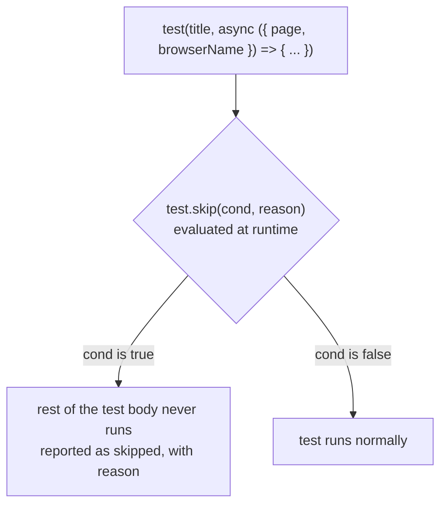
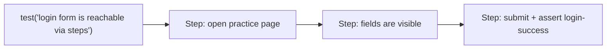
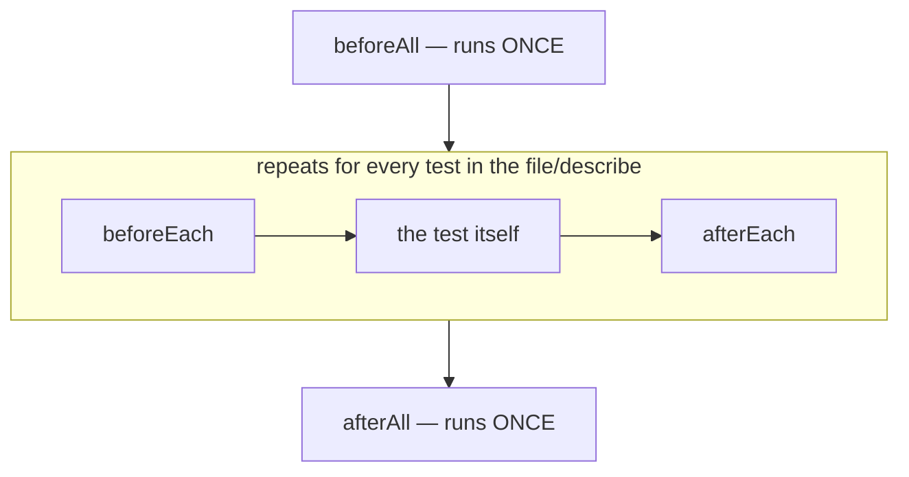
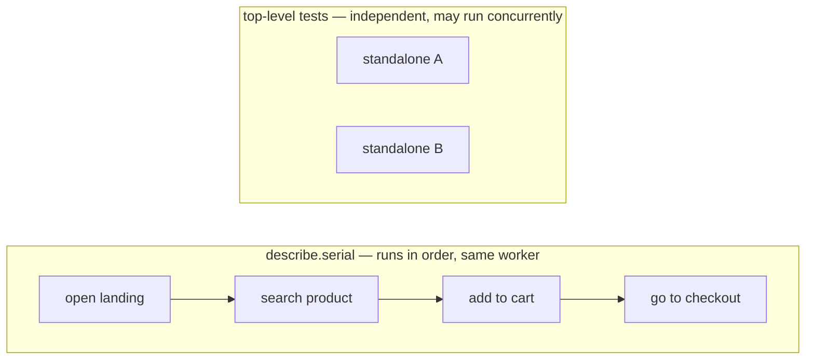
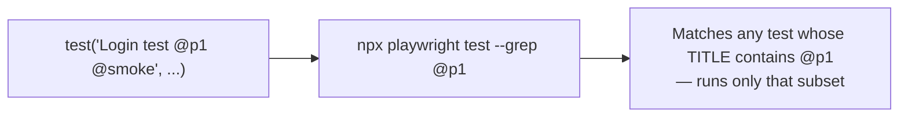

# 18_Test_hooks — Notes

Notes for everything covered in `tests/18_Test_hooks/`. This folder also ships two
standalone reference sheets worth bookmarking —
**[`TestHooks.md`](../tests/18_Test_hooks/TestHooks.md)** (every `test.*` function, hook, and
modifier) and **[`Chromium_Arguments_List.md`](../tests/18_Test_hooks/Chromium_Arguments_List.md)**
(Chrome launch flags, unrelated to hooks but filed here). These notes focus on what the five
spec files actually demonstrate. Diagrams are in Mermaid (renders natively on GitHub and in
VS Code's Markdown preview).

## File map

| File | Concept it teaches |
|---|---|
| `274_Test.spec.ts` | Conditional modifiers called **inside** the test body: `test.skip(cond, reason)`, `test.slow(cond, reason)`, `test.fixme`, unconditional `test.fail()` |
| `276_TestStep.spec.ts` | `test.step()` — named, nested steps in the report |
| `277_TestHook.spec.ts` | `beforeAll` / `beforeEach` / `afterEach` / `afterAll`, and `testInfo` inside a hook |
| `278_TestDescribe.spec.ts` | `test.describe.serial()` for order-dependent tests, alongside independent parallel tests |
| `279_TestPriority.spec.ts` | `test.describe.configure({ mode: 'serial' })` retroactively, and tag-based filtering with `--grep` |

---

## 1. Conditional modifiers: deciding per-test, not per-file

`274_Test.spec.ts` calls modifiers **inside** the test function body (not chained onto
`test(...)`), with the condition evaluated using fixtures like `browserName`:

```ts
test('title test', async ({ page, browserName }) => {
    test.skip(browserName === 'firefox', 'Feature not yet supported on Firefox');
    await page.goto(URL);
    await expect(page).toHaveTitle(/Multiple Element Filter/, { timeout: 15000 });
});

test('email is visible (slow on firefox)', async ({ page, browserName }) => {
    test.slow(browserName === 'firefox', 'firefox is slow on this layout');
    await page.goto(URL);
    await expect(page.getByRole('textbox', { name: 'Email Address' })).toBeVisible();
});

test.fixme('password is visible — broken in Safari, fix me', async ({ page }) => { ... });

test('expected to fail until backend ships', async ({ page }) => {
    test.fail();   // no condition = ALWAYS expected to fail
    await page.goto(URL);
    await expect(page.getByText('New customer area', { exact: true })).toBeVisible();
});
```



**Why call it inside the body instead of `test.skip(title, fn)` at the top level:** the
top-level form (`test.skip('name', fn)`) always skips — it has no access to fixtures yet. The
in-body form (`test.skip(condition, reason)`) runs *after* fixtures like `browserName` or
`isMobile` are available, so you can target exactly one browser/platform instead of the whole
test. The same shape works for `test.slow(cond, reason)` and `test.fail(cond, reason)`; calling
`test.fail()` with **no** arguments (as the last test does) means "this test is unconditionally
expected to fail" — useful for pinning a known, not-yet-fixed bug without deleting the test.

---

## 2. `test.step()` — structuring one test into named phases

```ts
test('login form is reachable via steps', async ({ page }) => {
    await test.step('open practice page', async () => {
        await page.goto('https://app.thetestingacademy.com/playwright/multiple_element_filter.html');
    });

    await test.step('fields are visible', async () => {
        await expect(page.getByRole('textbox', { name: 'Email Address' })).toBeVisible();
        await expect(page.getByRole('textbox', { name: 'Password' })).toBeVisible();
    });

    await test.step('submit + assert it lands on #login-success', async () => {
        await page.getByRole('button', { name: /Login/i }).click();
        await expect(page).toHaveURL(/#login-success$/);
    });
});
```



Steps don't change execution — it's still one test, one `page`/`context`. What they change is
the **report**: each step shows up as its own collapsible, timed row (visible in the HTML
reporter, the custom TTA reporter from `notes/05_Allure_Reporting.md`, and traces), so when a
long test fails you can see exactly *which phase* it died in without reading the stack trace
line by line.

---

## 3. The four hooks, and their order

```ts
test.beforeAll(async () => {
    console.log('beforeAll — server is up');   // once per worker for this file/describe
});

test.beforeEach(async ({ page }) => {
    await page.goto('https://app.thetestingacademy.com/playwright/');   // before every test
});

test('practice index has 47 cards', async ({ page }) => { ... });
test('sidebar collapse button works', async ({ page }) => { ... });

test.afterEach(async ({ page }, testInfo) => {
    if (testInfo.status !== testInfo.expectedStatus) {
        await page.screenshot({ path: `out/fail-${testInfo.title}.png`, fullPage: true });
    }
});

test.afterAll(async () => {
    console.log('afterAll — tear down');   // once, after every test in this file/describe
});
```



**The `afterEach(fn, testInfo)` pattern is the important one to take away:** `testInfo` gives
you the outcome of the test that just ran, so you can conditionally screenshot *only on
failure* instead of every single test — `testInfo.status !== testInfo.expectedStatus` is true
exactly when the test didn't end up the way it was supposed to (a normal test failed, or a
`test.fail()` test unexpectedly passed).

Scope: hooks apply to whatever file or `describe` block they're declared in. A `beforeAll`
inside a `describe` runs once for that group; one at file top-level runs once for the whole
file (per worker).

---

## 4. `test.describe.serial()` — when test order actually matters

```ts
test.describe.serial('Checkout suite — must run in order', () => {
    test('open landing', async () => { console.log('1'); });
    test('search product', async () => { console.log('2'); });
    test('add to cart', async () => { console.log('3'); });
    test('go to checkout', async () => { console.log('4'); });
});

// These two run in parallel — independent of the serial suite above.
test('standalone A', async () => { console.log('A'); });
test('standalone B', async () => { console.log('B'); });
```



By default, Playwright tests are independent and can run in parallel/any order — the right
default, since cross-test dependencies make suites fragile and hard to debug. `describe.serial`
is the explicit opt-out for the rare case where steps genuinely build on each other (like a
checkout flow). One more consequence worth knowing: inside a serial block, if one test fails,
Playwright skips the rest of that block (there's no point adding to cart if opening the landing
page already failed).

---

## 5. Retroactive serial mode + tag-based filtering

`279_TestPriority.spec.ts` shows a subtlety: `test.describe.configure({ mode: 'serial' })`
called **without** wrapping tests in a `describe(...)` block still affects the tests declared
**after** it in the same file:

```ts
test('TC01 - Login should work', async ({ page }) => { ... });     // runs in default (parallel) mode
test('TC02 - Dashboard should open', async ({ page }) => { ... }); // runs in default (parallel) mode

test.describe.configure({ mode: 'serial' });

test('Priority 1 - Login test', async ({ page }) => { ... });      // serial from here on
test('Priority 2 - Dashboard test', async ({ page }) => { ... });
test('Priority 3 - Logout test', async ({ page }) => { ... });
```

And separately, tagging tests in the title enables filtering from the CLI without touching the
test code:

```ts
test('Login test @p1 @smoke', async ({ page }) => { ... });
test('Profile test @p2', async ({ page }) => { ... });
test('Settings test @p3', async ({ page }) => { ... });

// npx playwright test --grep @p1
```



`--grep` (and the in-file `-g` flag covered in `notes/02_TestAnnotations.md` section 7 for
`describe` names) matches against the test **title string**, so `@p1`/`@smoke`/`@p2` are just
plain text conventions, not a built-in Playwright feature — but they're a very common pattern
for running "smoke tests only" or "P1s only" in CI without maintaining a separate file list.

---

## Quick recap

| Need | Reach for |
|---|---|
| Skip/slow/fail only under a specific condition | call `test.skip`/`test.slow`/`test.fail(condition, reason)` **inside** the test body |
| Mark a test as unconditionally expected to fail | `test.fail()` with no arguments |
| Break a long test into labeled, reportable phases | `await test.step('name', async () => { ... })` |
| Run setup once per file/group | `test.beforeAll()` |
| Run setup before every test | `test.beforeEach()` |
| React to a test's outcome (e.g. screenshot on failure only) | `test.afterEach(async (fixtures, testInfo) => { if (testInfo.status !== testInfo.expectedStatus) ... })` |
| Force tests to run in order, stop the group on first failure | `test.describe.serial(name, () => { ... })` |
| Switch mode for tests below a line, without a `describe` wrapper | `test.describe.configure({ mode: 'serial' })` |
| Run only a subset by convention tag | title with `@tag`, then `npx playwright test --grep @tag` |
| Full `test.*` API reference | [`TestHooks.md`](../tests/18_Test_hooks/TestHooks.md) in this topic's folder |
