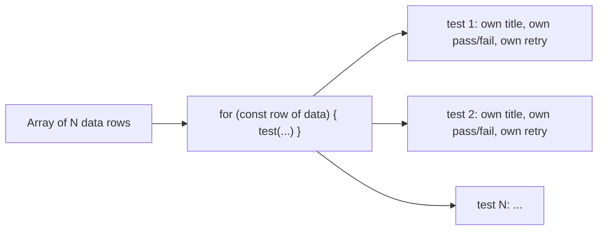
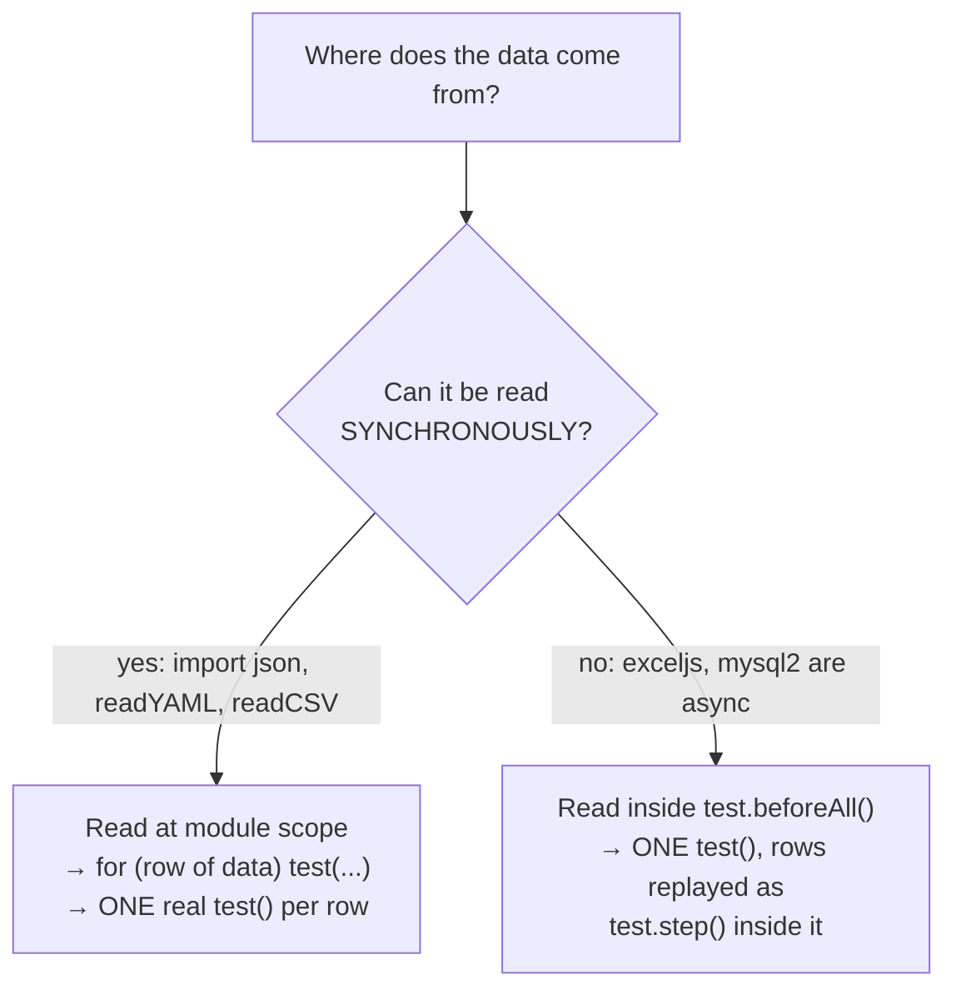
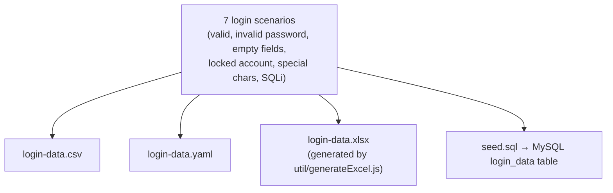

# 19_Data_Driven_Testing — Notes

By far the biggest topic folder so far — the same login scenario, driven from five
different data sources (JSON, CSV, YAML, Excel, MySQL) plus one that generates its own
data (Faker), all converging on one core technique. Diagrams are in Mermaid (renders
natively on GitHub and in VS Code's preview).

## File map

| File | Concept it teaches |
|---|---|
| `279_DDT.spec.ts` + `280_Users.json` | Importing a plain JSON object directly as a module |
| `281_TestData.json` | A JSON array of objects, including nested objects and arrays (not consumed by a spec yet) |
| `282_Login_DDT.spec.ts` + `test-data/login.json` | Two *named* data cases (`validUser`/`invalidUser`), not looped |
| `283_Read_Write_FileSystem.ts` | Reading/writing JSON by hand with `fs`, instead of `import` |
| `284_DDT_JSON_Array.spec.ts` | **The core pattern**: loop an array, generate one `test()` per row |
| `285_DDT_CSV.spec.ts` + `util/csvReader.ts` | Same pattern, data from a hand-rolled CSV parser — ⚠️ has a real bug |
| `286_JSON_DDT.spec.ts` + `test-data/registration-data.json` | Same pattern again, `test.afterEach` logging each row's result |
| `287_DDT_EXCEL.spec.ts` + `util/excelReader.ts` | Same *dataset*, but async (`exceljs`) — different code shape as a result |
| `288_DDT_YAML.spec.ts` + `util/yamlReader.ts` | Same dataset again, YAML — sync, so back to one `test()` per row |
| `289_DDT_MYSQL.spec.ts` + `util/dbReader.ts` | Same dataset from a real database — async, plus `test.skip` when unconfigured |
| `290_DDT_Faker.spec.ts` | No fixture file at all — synthetic data generated fresh every run |

---

## 1. The core pattern: loop over data, generate a test per row

Everything in this folder is a variation on one idea, clearest in `284_DDT_JSON_Array.spec.ts`:

```ts
const loginData = [
  { description: "valid credentials", username: "admin@gmail.com", password: "admin123" },
  { description: "invalid password", username: "admin123@ymail.com", password: "wrongpass" },
  // ...
];

for (const data of loginData) {
  test(`Login with : ${data.description}`, async ({ page }) => {
    await page.locator("#email").fill(data.username);
    await page.locator("#password").fill(data.password);
    await page.getByTestId("login-button").click();
  });
}
```

This runs *outside* any `test()` block, at the top level of the file — which is exactly
what makes it work. Playwright collects (discovers) tests by literally running each spec
file once before anything executes; every `test(...)` call made during that pass registers
one test. A `for` loop calling `test()` five times at the top level registers five separate,
independently-reportable, independently-retriable tests — not one test that loops five
times internally. Confirmed by actually listing this folder's tests:
`npx playwright test tests/19_Data_Driven_Testing --list` shows each row as its own line,
e.g. `DDT CSV › Login with : valid credentials`, `DDT CSV › Login with : locked account`, etc.



Everything else in this folder is really answering one question: **how do you get the
array in the first place?**

---

## 2. Two other JSON shapes, before the array pattern

Not every data file in this folder is "an array to loop." Two earlier files show simpler
JSON shapes worth distinguishing:

```ts
// 279: one flat object, imported directly — no loop, just values
import userData from './280_Users.json';
console.log(userData.username);

// 282: an object with two NAMED cases — still no loop, two separate hand-written tests
import loginData from './test-data/login.json';
test("login with valid user", async ({ page }) => {
  await page.locator("#email").fill(loginData.validUser.email);
});
test("login with invalid user", async ({ page }) => {
  await page.locator("#email").fill(loginData.invalidUser.email);
});
```

`import x from './file.json'` works directly in TypeScript/Node — no `fs` needed — because
JSON files are resolvable as modules. This is the simplest option whenever the data is
fixed and known at compile time. It stops being enough the moment you want to *generate*
a test per entry in a list, which is why `284` switches to the loop pattern once the data
becomes an array.

---

## 3. Reading/writing JSON manually with `fs`

`283_Read_Write_FileSystem.ts` is a plain library script (not a spec — no `test()` block),
showing the manual alternative to `import`:

```ts
const filePath = path.join(__dirname, '280_Users.json');
const fileData = fs.readFileSync(filePath, 'utf-8');
const userDataJSObject = JSON.parse(fileData);

// writing is the mirror image
fs.writeFileSync("output.json", JSON.stringify({ name: "Pratik", role: "QA" }));
```

**When this is necessary instead of `import`:** when the file path isn't known until
runtime (built from a CLI arg, an environment variable, or — as in `285`'s CSV reader —
a path passed into a reusable function), or when you also need to *write* a file, which
`import` obviously can't do.

**Nice detail worth copying into other topics:** this file uses `import * as path from 'node:path'`
and `import * as fs from 'node:fs'` — the `node:` prefix makes it unambiguous that you want
Node's built-in module, which can *never* be shadowed by an npm package of the same name.
That's actually the clean fix for the `"path"` npm-package mixup flagged in
`notes/14_FileUpload.md` section 5 — worth updating those older files to `node:path` too.

---

## 4. The real split this topic is built around: sync vs. async data sources

This is the single most important concept in the folder, and `287_DDT_EXCEL.spec.ts`'s own
comment already explains it better than most textbooks:

> exceljs is asynchronous, and Playwright collects tests *synchronously*. There is no way
> to `await` at module level and still produce one `test()` per row, so the rows are loaded
> in `beforeAll` and replayed as `test.step()`s inside a single test.



| | Sync readers (JSON import, `readYAML`, `readCSV`) | Async readers (`readExcel`, `readLoginDataFromDB`) |
|---|---|---|
| When is data available | At module load — before Playwright finishes collecting tests | Only inside a hook/test — after collection already happened |
| Result | One real `test()` per row | One `test()`, rows replayed via `test.step()` |
| Report | Each row gets its own pass/fail/retry | All rows share one pass/fail; steps show the per-row breakdown |
| Files that do this | `282`, `284`, `285`, `286`, `288` | `287`, `289` |

**If you need one real `test()` per row from an async source anyway:** `287`'s own comment
gives the answer — pre-generate a JSON file from the async source inside Playwright's
`globalSetup`, then `import` that JSON synchronously the normal way. `globalSetup` runs
once before test collection, so by the time Playwright scans spec files, the data is
already a plain synchronous JSON file.

---

## 5. Five formats, one dataset — a genuinely good design choice

`test-data/login-data.csv`, `login-data.yaml`, `login-data.xlsx`, and `seed.sql` all encode
the **same seven login scenarios** (valid credentials, invalid password, empty username,
empty password, locked account, special characters, SQL injection attempt) — confirmed by
reading `seed.sql`'s own header comment ("Same seven rows as login-data.csv / .xlsx / .yaml").
This is worth calling out as a deliberate, good choice: it isolates "how do I read format X"
as the only variable between `285`/`287`/`288`/`289`, instead of also changing what's being
tested each time.



---

## 6. ⚠️ Real issues found in this topic (verified, not just suspected)

### `login-data.xlsx` was a 0-byte empty file

Checked directly: the committed `.xlsx` was 0 bytes — `generateExcel.js`'s own doc comment
says to run `node tests/19_Data_Driven_Testing/util/generateExcel.js` to produce it, which
apparently never happened (or the output was never saved back). Running `287_DDT_EXCEL.spec.ts`
as committed would fail the moment `exceljs` tries to open an empty file, before a single
row is read. **I ran the generator script to fix this** (`node util/generateExcel.js` — a
plain script, not a git operation) — it now contains the expected 7 rows, and
`npx playwright test tests/19_Data_Driven_Testing --list` confirms `287` collects its test
correctly. Re-run the generator any time the shared dataset changes, so the `.xlsx` doesn't
drift out of sync with the CSV/YAML/SQL versions again.

### `csvReader.ts`'s hand-rolled parser breaks on quoted fields — confirmed, not theoretical

```ts
let values = lines[i].split(',');   // naive split — no quote-awareness at all
```

Real CSV allows a field to contain a comma or a literal quote by wrapping it in double
quotes (`"like, this"`), with `""` as an escaped quote inside one. `readCSV` doesn't handle
any of that — it just splits on every comma. The CSV file's last row,
`"SQL injection","admin' OR '1'='1",password,false,Invalid credentials`, happens to have no
*comma* inside its quoted fields, so the column count doesn't shift — but the quote
characters themselves are never stripped, so they end up baked into the value. This is
directly visible in the actual generated test title:
**`DDT CSV › Login with : "SQL injection"`** — compare to every other row in the same file
(`Login with : valid credentials`, `Login with : locked account`, no quotes) to see the
difference. `data.username` for that row is similarly `"admin' OR '1'='1"` (quotes
included), not the clean value you'd expect. A real CSV parser (or a small library) would
avoid this — hand-rolling `split(',')` only works for CSVs that never quote a field.

### `285_DDT_CSV.spec.ts` asserts on a column the CSV doesn't have

```ts
await expect(page).toHaveURL(data.expectedURL);
```

`login-data.csv`'s header row is `description,username,password,shouldPass,expectedError`
— there is no `expectedURL` column. `data.expectedURL` is `undefined` for every row, so this
assertion isn't actually checking what the test's data implies it should be checking.
Likely copy-pasted from `284_DDT_JSON_Array.spec.ts`, which *does* define `expectedURL` in
its inline array. Worth either adding a real `expectedURL` column to the CSV, or changing
the assertion to match what the CSV actually provides (`shouldPass`/`expectedError`).

### `exceljs`, `js-yaml`, `mysql2`, `@faker-js/faker`, `@types/js-yaml` aren't in `package.json`

Checked `node_modules` directly — all five are installed locally (confirmed versions:
`exceljs@4.4.0`, `js-yaml@5.5.0`, `mysql2@3.24.6`, `@faker-js/faker@10.6.0`,
`@types/js-yaml@4.0.9`) and that's why `287`–`290` run fine *here*. But `package.json`
doesn't list any of them. Anyone cloning this repo fresh and running `npm install` would
get a `node_modules` **without** these packages, and `287`, `288`, `289`, and `290` would
all fail immediately with `Cannot find module`. Not fixing this one automatically (per
earlier feedback about not editing `package.json` without being asked) — just flagging it
clearly: if you want this topic to survive a fresh clone, these need adding to
`dependencies`/`devDependencies`.

---

## 7. MySQL: async data + a conditional skip

```ts
test.skip(!isDbConfigured(), 'MYSQL_HOST is not set, see .env.example');
```

This is the exact conditional-skip pattern from `notes/02_TestAnnotations.md` section 5
(`test.fixme(condition, reason)`), applied to `test.skip` at the `describe` level instead
of inside one test: if `MYSQL_HOST` isn't set in `.env`, the whole suite is skipped with a
clear reason instead of failing with a confusing connection error. `dbReader.ts` reads its
connection config from `process.env.MYSQL_*`, defaulting sensibly (`localhost`, `3306`,
`root`, empty password, `playwright_ddt`) so a local MySQL with defaults "just works" once
`MYSQL_HOST` is set at all.

---

## 8. Faker: no fixture file, fresh data every run

```ts
const users = faker.helpers.multiple(() => ({
  name: faker.person.fullName(),
  email: faker.internet.email().toLowerCase(),
  password: faker.internet.password({ length: 12 }),
}), { count: 5 });
```

`faker.helpers.multiple(fn, { count })` calls `fn` five times and collects the results —
still a plain synchronous array by the time it reaches the same `for (const user of users)`
loop as every other file here. The tradeoff versus a fixture file: Faker data is different
on every run (useful for fuzzing/volume, bad for reproducing a specific reported failure,
since there's no fixed row to point back to) — fixtures (CSV/JSON/YAML) are the opposite:
identical every run, easy to reference ("the 'locked account' row failed again").

---

## Quick recap

| Need | Reach for |
|---|---|
| Fixed data known at compile time | `import data from './file.json'` |
| Path only known at runtime, or need to write too | `fs.readFileSync`/`writeFileSync` + `JSON.parse`/`stringify` |
| One `test()` per data row | `for (const row of data) { test(\`...${row.x}\`, ...) }` at the top level of the file |
| Data source is synchronous (JSON, YAML, hand-rolled CSV) | Read at module scope — real one-test-per-row works |
| Data source is asynchronous (Excel via exceljs, a DB) | Read in `test.beforeAll()`; replay rows via `test.step()` inside one `test()` |
| One test() per row from an async source anyway | Pre-generate a JSON file in `globalSetup`, `import` it synchronously |
| Skip a whole suite when infra isn't configured | `test.skip(!isConfigured(), 'reason')` at the describe level |
| Need N realistic-but-fake records, no fixture file | `@faker-js/faker`'s `faker.helpers.multiple(fn, { count })` |
| Parsing real-world CSV (quotes, embedded commas) | Don't hand-roll `split(',')` — use a real CSV parser, or expect quoted/comma-containing fields to break |
